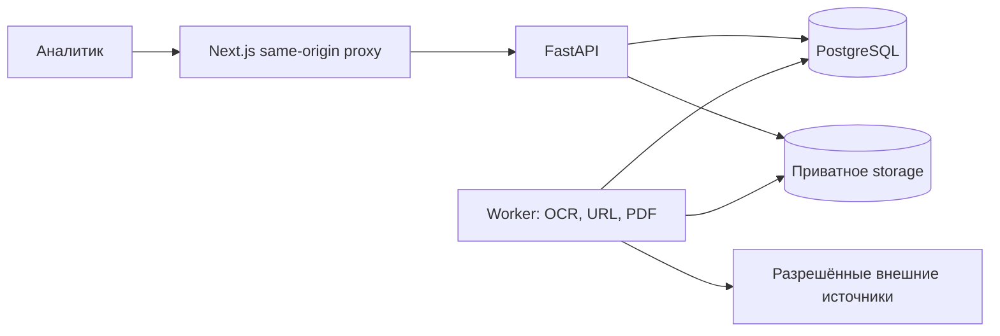

# SAQ QURYLYS

Рабочее место аналитика для проверки признаков риска в рекламе долевого жилищного строительства Казахстана. Система сохраняет источники, помогает проверять гипотезы и готовить сигналы; она не устанавливает факт правонарушения.

## Возможности и статус

Реализованы материалы TXT/PNG/JPEG/пассивные PDF, OCR RU/KZ, ручная проверка гипотез и сопоставлений, доказательства, отдельные решения R1–R6, реестр и карта, история, неизменяемые снимки сигналов и PDF. Есть CSV intake, ограниченный импорт разрешённых HTML-страниц, явно включаемые URL-расписания и версионные профили/словари/находки Social Monitor V2.

Live-доступ к социальным платформам, принятый официальный REAL-реестр, независимая RU/KZ/OCR/предметная приёмка и проверка на втором физическом ПК остаются открытыми. UI и endpoint не доказывают доступ к внешнему источнику. Подробности — [статус](PROJECT_STATUS.md) и [чеклист](docs/REMAINING_CHECKLIST.md).

## Быстрый запуск через Docker

Нужны Git, Python 3.12+ и Docker с Linux engine / Compose v2.35+; Windows: Docker Desktop с WSL2. Для контейнерного запуска Node.js и локальный Tesseract не нужны. Используйте новую отдельную папку:

```sh
git clone https://github.com/temirkhanerbolatovich-coder/saq-qurylys.git
cd saq-qurylys
git switch codex/repository-cleanup
python scripts/configure_local.py
```

Откройте [localhost:3000](http://localhost:3000). Первый логин/пароль — в приватном .local/credentials.txt. Генератор отказывается перезаписывать существующие секреты. Для пустой установки вместо обычного вызова используйте python scripts/configure_local.py --no-demo-seed.

На Windows после генерации:

```powershell
docker compose up --build -d --wait --wait-timeout 300
```

### Первый запуск на Linux/WSL

После генерации конфигурации и до первого up подготовьте новое хранилище для непривилегированного пользователя API:

```sh
docker compose build
mkdir -p storage
docker compose run --rm --no-deps --user root --entrypoint chown api saq:saq /app/storage
docker compose up --no-build -d --wait --wait-timeout 300
```

Это действие относится к новой папке storage. API применяет миграции перед стартом, затем идемпотентный DEMO seed либо bootstrap-only. Worker стартует после health API.

Проверка и остановка с сохранением данных:

```sh
docker compose ps
python scripts/check_readiness.py
docker compose logs --tail 100 api worker frontend
docker compose stop
```

Readiness helper предназначен для штатного локального project и не является полной приёмкой. Health внутри API: docker compose exec -T api python -c "import urllib.request; print(urllib.request.urlopen('http://127.0.0.1:8000/health').status)".

## Первый вход и DEMO

Создайте DEMO текст → явно запустите анализ → проверьте гипотезу и сопоставление → сохраните доказательство → примите отдельное решение о факторе → создайте снимок сигнала и PDF. OCR и matching предлагают гипотезы; решение принимает аналитик. Выдуманные объекты и файлы помечены DEMO. UNKNOWN не означает отсутствие правового основания.

## Архитектура и структура

Next.js / TypeScript / React / Tailwind; FastAPI / Pydantic / SQLAlchemy / Alembic; PostgreSQL 17; Tesseract rus+kaz+eng; WeasyPrint/Pango. Точные версии закреплены в package-lock.json и requirements*.txt.



| Путь | Назначение |
|---|---|
| frontend/ | UI, proxy, компоненты, browser/Node tests |
| backend/ | API, worker, модели, миграции, pytest |
| contracts/ | Версионный OpenAPI |
| scripts/ | Конфигурация, проверки и обслуживание |
| data/ | Seed и синтетические evaluation fixtures |
| docs/ | Руководства, ADR, evidence и архив |
| .github/ | CI и шаблоны участия |
| .agents/skills/ | Закреплённый UI Skill с лицензией, вне runtime image |

## Разработка и документация

Для native-разработки нужны Python 3.12, Node.js 24 и PostgreSQL. Полный OCR/PDF runtime поддерживается в Linux-контейнерах.

- [Разработка и проверки](docs/DEVELOPMENT.md).
- [Чистая изолированная установка](docs/CLEAN_INSTALL_ACCEPTANCE.md).
- [Linux VPS, HTTPS, обновление и откат](docs/DEPLOYMENT.md).
- [Резервные копии](docs/operations/BACKUP_RESTORE.md).
- [Диагностика](docs/TROUBLESHOOTING.md).
- [API](docs/API.md), [архитектура](docs/ARCHITECTURE.md).
- [Правила PR](CONTRIBUTING.md), [безопасность](SECURITY.md).
- [Все документы по темам](docs/README.md).

Команды и фактические результаты этой ревизии — [REFACTOR_REPORT](docs/REFACTOR_REPORT.md). Исторические результаты не являются повторной проверкой текущего кода.

## Безопасность и ограничения

Сессии, роли analyst/viewer, CSRF и Origin обязательны. API/БД по умолчанию не публикуются; UI слушает loopback. Оригиналы/PDF приватны. Не коммитьте .env, dumps, storage или tokens. E2E запускаются только на disposable установке.

Риск считает backend: только CONFIRMED R1–R6, веса 35/25/10/15/10/5; красная зона требует ≥60 и R1+R2. Неизвестность, отсутствие строки реестра и ошибка доступа не дают R1. Исторические snapshots/PDF не переписываются.

Единая лицензия на весь проект владельцем не объявлена. Публичный доступ к исходникам не означает разрешение на переиспользование. Сторонние лицензии, включая UI Skill, сохранены; [первичные документы](docs/reference/README.md) не перелицензируются.
