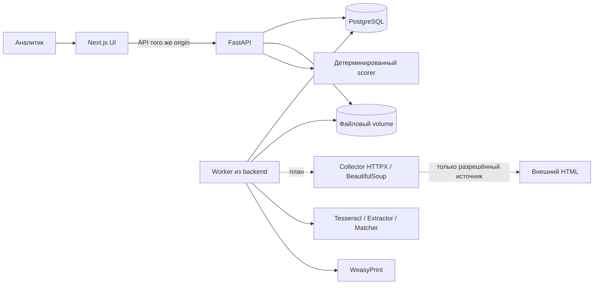

# SAQ QURYLYS — архитектура MVP

Базовая архитектура согласована 14.10.2026; текущая реализация 15.10.2026 соответствует контрактному этапу 0.8.0-mvp. Реестр/ручной ввод, OCR/гипотезы/matching, документы и ручные R1–R6, снимки/решения сигналов и PDF реализованы. Collector, карта и произвольное историческое воспроизведение риска остаются целевыми компонентами. Проверены 217 backend-тестов в Linux и 16 browser-тестов; полная приёмка P0 ещё не завершена. Основание требований — [REQUIREMENTS.md](REQUIREMENTS.md), фактические проверки — [PROJECT_STATUS.md](../PROJECT_STATUS.md).

Текущая реализация очереди, версия текста и пересмотр риска описаны в [срезе 02](IMPLEMENTATION_SLICE_02.md) и [ADR-002](decisions/ADR-002-durable-analysis-review.md). Датированная проверка правовых оснований: [feature](FEATURE_LEGAL_BASIS.md), [ADR-003](decisions/ADR-003-dated-legal-applicability.md). Текущая применимость вычисляется при чтении, VERIFIED_ABSENT не создаётся при отклонении документа. Независимые источники R3/R5/R6, разные SHA, даты/сопоставимость и отдельные решения: [feature](FEATURE_CONSTRUCTION_REVIEW.md), [ADR-004](decisions/ADR-004-dated-construction-evidence.md). Составная проверка отсутствия всех механизмов/R1: [feature](FEATURE_LEGAL_ABSENCE.md), [ADR-005](decisions/ADR-005-dated-all-mechanism-absence.md); as_of оценки отделён от reviewed_at. Коррекция расшифровки или привязки снимает зависимый R3 до повторной проверки. Сигналы и PDF: [feature](FEATURE_SIGNALS.md), [ADR-006](decisions/ADR-006-immutable-signals-pdf.md), миграция e87f4d01a921.

## Семь основных решений

| № | Решение | Почему | Цена/ограничение |
|---|---|---|---|
| 1 | Один репозиторий, модульный backend, отдельный worker из той же сборки | Общая модель и транзакции, простой запуск, без микросервисных контрактов | API и worker обновляются совместно |
| 2 | Next.js/TypeScript/Tailwind + FastAPI/Pydantic/SQLAlchemy/Alembic + PostgreSQL | Следует профилю CODEX_TZ; SQL-транзакции связывают решение, риск и аудит | Два языка; версии и lock-файлы поддерживаются совместно |
| 3 | PostgreSQL — очередь заданий и источник бизнес-состояния; файловый volume — оригиналы и PDF | Задачи переживают рестарт, не нужен Redis; файлы не раздувают БД | Нужен lease/recovery и согласованный backup БД+файлов |
| 4 | Tesseract rus+kaz+eng → правила RU/KZ → RapidFuzz → ручная проверка | Содержательный OCR на новом вводе; правила прозрачны; LLM не блокирует P0 | Качество измеряется отдельно; неоднозначные случаи идут человеку |
| 5 | Риск рассчитывает только backend, из подтверждённых фактов, с версией и снимком сигнала | A/B/C воспроизводимы; результат можно объяснить и пересмотреть | Требуются отдельные статусы гипотез, факторов, сигналов |
| 6 | План: Leaflet и один настраиваемый raster-провайдер; координаты seed вручную | Для восьми объектов достаточно; не нужны 3D/GIS и второй движок | Карта ещё не реализована; сеть/условия тайлов; при отказе остаётся реестр; никаких bulk offline tiles |
| 7 | Локальное демо в Linux-контейнерах, серверная идентичность аналитика, изолированный импорт | OCR/PDF имеют системные зависимости; автор решения проверяется сервером | Локальный Docker проверен; второй ПК, public production и ведомственный SSO отдельны |

Общее архитектурное обоснование — [ADR-001](decisions/ADR-001-mvp-baseline.md). Базовая архитектура принята пользователем; реализация подтверждается отдельно по срезам.

## Компоненты и потоки



UI вызывает API через same-origin proxy. Браузер не обращается к БД, хранилищу или collector напрямую. Backend создаёт job и отвечает 202. Worker получает job из БД, сохраняет исходный материал, затем версии OCR/извлечения/кандидатов. Результат анализа не меняет CONFIRMED-факторы. Analyst review отдельной командой создаёт решение.

При подтверждении фактора backend проверяет доказательства, область/дату, роль и optimistic version; в одной транзакции с блокировкой строки объекта/риска сохраняет событие проверки, обновляет актуальный фактор, пересчитывает риск и добавляет audit_event. Это сериализует и одновременные решения по разным факторам одного объекта. Ошибка откатывает всё. После ответа UI обновляет объект и summary; WebSocket/SSE для MVP не нужен.

Создание сигнала фиксирует снимок текущей версии риска и доказательств. Утверждение требует совпадения версии со свежим состоянием объекта; иначе 409 и новый снимок. Изменения факторов помечают предыдущие сигналы устаревшими для текущего решения, но не меняют их историческое содержимое/PDF. PDF-asset привязывается к снимку и конкретной ревизии решения; PDF черновика после утверждения остаётся отдельным историческим asset, его файл не перезаписывается. GET pdf возвращает файл актуальной ревизии решения, прежние файлы доступны через сохранённые asset-ссылки. Доработка возвращённого сигнала создаёт новую версию через POST signals с previous_signal_id.

## Модель данных

| Сущность | Ответственность и важные связи |
|---|---|
| users, sessions | Локальные учётные записи аналитиков; сервер определяет автора и роль |
| developers | Юридические лица с ролью застройщика/уполномоченной компании/подрядчика; БИН с происхождением |
| properties | ЖК/очередь/корпус: parent_id, level, имя/алиасы, город, адрес, stage, готовность и дата, отдельные latitude/longitude, is_demo |
| legal_bases | Механизм, документ, проверка, применимость во времени; property_id указывает конкретную область, наследования нет |
| advertisements | Публикация, неизменяемый исходный текст, URL/площадка, published_at nullable, captured_at, revision, is_demo |
| advertisement_assets | Сохранённые текст/HTML/изображения, тип, размер, SHA-256, безопасный storage_key |
| extraction_results | Версия pipeline, исходный OCR, исправления отдельной версией, поля с offsets/bbox, решения о гипотезах |
| property_matches | Кандидаты и строковое сходство; отдельная история ручного выбора/отклонения |
| evidence | Ссылка на конкретную версию материала/документа, буквальный фрагмент и даты; R5 — два датированных значения |
| risk_factor_reviews | Решения по кодам R1–R6: статус, область, период, evidence_ids, автор, reason, revision; предыдущие решения сохраняются |
| signals | Неизменяемый JSONB-снимок, previous_signal_id, решение/автор/время, pdf_job_id и PDF-asset точной ревизии; аудит хранит историю команд |
| audit_events | Действие, actor_id, время, объект, old/new revision, причина, request_id; секретов и полного PII нет |
| analysis_jobs | ANALYZE / RENDER_PDF, state, stage, attempt, lease_until, ошибка, idempotency_key; IMPORT_URL запланирован |

Схему можно объединять только без потери происхождения и истории. ORM-модели — внутренние; наружу отдельные Pydantic DTO. JSONB допустим для вариативных полей извлечения/снимка, но не вместо ключей/связей и статусов.

UUID для идентификаторов; ISO-8601 timestamps с offset, UTC в БД; отображение Asia/Qyzylorda (+05:00). Unknown даты/координаты остаются null. Денежные суммы передавать десятичной строкой и хранить Numeric, не binary float. Географические поля названы явно, без неоднозначного порядка массива.

## Состояния и инварианты

- Job: QUEUED → RUNNING → SUCCEEDED / FAILED / BLOCKED. BLOCKED означает, например, запрет доступа источника; ERROR не интерпретируется как отсутствие объекта.
- Гипотеза: PENDING → CONFIRMED / CORRECTED / REJECTED. Исправление сохраняет оригинал; смысловая коррекция требует причины.
- Match: PENDING → CONFIRMED / REJECTED. Выбор одного кандидата не подтверждает остальные. Изменение подтверждённой связи требует повторной проверки зависимых факторов.
- Legal verification: UNKNOWN / PENDING / VERIFIED_VALID / VERIFIED_ABSENT / REJECTED. Новое отсутствие всех механизмов фиксируется отдельным датированным R1, не статусом отдельного LegalBasis и не бессрочным агрегатом объекта. Текущий legal status вычисляется из документов; legal_absence_as_of показывает дату CONFIRMED R1 отдельно. Legacy DEMO VERIFIED_ABSENT сохраняется до явного пересмотра старого R1; пустой legal_bases не создаёт его.
- Фактор: UNKNOWN / PENDING / CONFIRMED / REJECTED. В текущей реализации одна актуальная запись на property_id+code; её as_of и прежние решения сохраняются в аудите. Отдельного набора факторов для каждого исторического периода пока нет. UNKNOWN/PENDING/REJECTED = 0.
- Сигнал: DRAFT → CONFIRMED / RETURNED; новая редакция отдельной записью. PDF generation_state отдельно: NOT_REQUESTED / QUEUED / READY / FAILED.

R1 требует одного LEGAL_ABSENCE_REVIEW с конкретной областью, absence_as_of, датой документа и отдельными результатами/причинами всех трёх проектных механизмов. Неполные/UNKNOWN/NOT_FOUND/UNAVAILABLE материалы можно сохранить, но нельзя подтвердить по ним R1. Факты evidence копируются сервером из самостоятельного документа с проверкой SHA. Дата документа может быть позже оцениваемого отсутствия; as_of фактора должна точно совпасть с absence_as_of. Это проектная процедура, не автоматическое юридическое заключение.

Применимый VERIFIED_VALID или неразрешённый PENDING того же ЖК на дату отсутствия блокирует создание/подтверждение R1 с 409; учитываются период и календарная дата выдачи документа. Обратное подтверждение VERIFIED_VALID на дату уже CONFIRMED R1 также блокируется. Наличие гарантии другого корпуса или документа более позднего периода не создаёт этого противоречия. Новые контрматериалы PENDING сохраняются для ручного разрешения; старое решение не отменяется скрыто.

При подтверждении R1 или R2 сервер дополнительно проверяет перспективную пару CONFIRMED: нужна известная published_at хотя бы одного проверенного источника оплаты, точно совпадающая с as_of R1 как timezone-aware момент. captured_at и reviewed_at не заменяют дату публикации. Несогласованные события, включая разные моменты одного дня, дают 409 в обоих порядках подтверждения. Формула/веса сохранены; R2/R3 без R1 не требуют такой пары. Строгое равенство — консервативное ограничение текущей модели без интервалов отсутствия. R5 отдельно проверяет два сопоставимых evidence и расхождение ≥20 п.п.

Произвольный расчёт риска на историческую дату ещё не реализован. Сигнал уже сохраняет фактические as_of и версии решений в историческом снимке; более поздний документ не меняет этот JSON или ранее выпущенный PDF. Отсутствующий период или юридическая неопределённость требуют ручного решения, а не придуманной автоматической даты истечения.

## Надёжность worker

Один worker в MVP. Задание захватывается атомарно в PostgreSQL, сохраняются lease и attempts; истёкший RUNNING восстанавливается без повторного бизнес-эффекта. Новая команда с тем же Idempotency-Key и тем же телом возвращает прежний результат; с другим телом — 409. Повторный анализ создаёт новую версию извлечения, не затирает рассмотренную.

Анализ и PDF используют одну очередь с ограниченным числом попыток, lease и claim token. PDF дополнительно проверяет target_revision и текущий pdf_job_id перед публикацией результата: поздний worker не меняет файл нового решения. Рендер выполняется в subprocess с PDF_TIMEOUT_SECONDS (default 60, диапазон 1–90), ограничениями входа и результата. Сетевые timeout/retry-параметры collector остаются проектными до выбора разрешённого источника; бесконечные retries и обход 401/403/CAPTCHA не предусмотрены.

## Безопасность и границы доверия

Для localhost-демо — серверные сессии, password hash, login/logout/me, cookie HttpOnly/SameSite, CSRF token для небезопасных методов и проверка Origin. Автор из сессии; actor_id из request body не принимается. Две роли достаточно: analyst (работа и проверка), viewer (чтение). Второй обязательный проверяющий и ведомственный SSO не заявлены реализованными.

В Compose наружу по умолчанию привязывается только UI к 127.0.0.1; API/БД внутри сети. Public deploy требует отдельной конфигурации TLS, Secure cookies, доступа и хранения; сейчас не выполняется. Нельзя открывать demo-mode с общей идентичностью в интернет.

Требования к будущему URL-импорту: allowlist домена и путей, только HTTP(S), запрет credentials и произвольных портов; проверка DNS/всех редиректов, запрет private/loopback/link-local/reserved IP, защита от DNS rebinding закреплением проверенного адреса. Прокси из окружения не наследовать без настройки. Копия HTML хранится как данные; не исполнять scripts, не отображать raw HTML в UI. robots.txt — дополнительный технический сигнал, а не единственное доказательство разрешения. Сейчас collector BLOCKED без разрешённого источника.

Uploads сейчас: PNG/JPEG/TXT для рекламы и supporting documents; загрузка PDF-документов ещё не поддерживается. Проверяются содержимое/MIME, размер MAX_UPLOAD_BYTES и ограничения изображения; случайный storage_key вне webroot, запрет traversal и inline active content. OCR — subprocess с timeout и без shell. Файлы доступны через авторизованный endpoint, имена файлов не становятся путями.

PDF: только доверенный server-side шаблон, экранирование текста, локальные шрифты с RU/KZ, custom resource loader без сети и без произвольного file://. Оригинал рекламы не становится HTML/CSS шаблоном WeasyPrint. Логи не содержат секреты, session/CSRF tokens и лишние персональные данные.

Аудит приложения append-only для штатных операций, но администратор БД технически может его изменить. SHA-256 обнаруживает изменение сохранённого файла, не доказывает авторство/законность/судебную допустимость. Production retention, backup/restore и усиление аудита — отдельный этап.

## Структура после согласования

```text
frontend/                  Next.js app, components, API client, browser tests
backend/app/               api, schemas, models, services, worker, configuration
backend/tests/             unit и API/БД integration
backend/alembic/            миграции
contracts/openapi.yaml     согласованный внешний контракт
data/seed/                 синтетические ЖК, объявления и материалы
docs/                      требования, архитектура, UX, приёмка, решения
docker-compose.yml         UI, API, worker, PostgreSQL и volumes
.github/workflows/         проверки и сборка
```

Worker, uploads, анализ, предметные модули review, сигналы и PDF реализованы; collector остаётся целевым компонентом. Не добавлять универсальные repository/service/adapter-фабрики без конкретной потребности. Небольшие модули предметных сценариев предпочтительнее общего «менеджера».

## Контракт и проверка архитектуры

`contracts/openapi.yaml` — контракт 0.8.0-mvp с implementation metadata: 36 операций, 34 реализованы полностью, 1 частично и 1 PLANNED (collector). Login/me/CSRF, чтение объявления, review извлечения/документов/факторов R1–R6, выдача материалов и аудит расширяют исходный список CODEX_TZ; дополнения маркируются x-origin: proposal. Partial остаётся valid/rejected review отдельного LegalBasis: VERIFIED_ABSENT намеренно проходит отдельным составным R1, а не review одного основания.

OpenAPI и схемы реальных ответов проверяются backend-тестами; локальные итоговые прогоны — 279 backend в Linux и 17 browser. Первый удалённый [CI](https://github.com/temirkhanerbolatovich-coder/saq-qurylys/actions/runs/38696142426) для `dc595e2` прошёл: backend tests/migrations и frontend checks/build; в новом [CI 20ab6f4](https://github.com/temirkhanerbolatovich-coder/saq-qurylys/actions/runs/38703582239) все три jobs прошли, включая browser-e2e с Compose/OCR/PDF (279 backend / 17 browser). Второй ПК, backup/restore и предметная приёмка остаются открыты: [чеклист](REMAINING_CHECKLIST.md).

Исходные PDF проходят строгую проверку pypdf в отдельном Linux subprocess с CPU/AS/wall limits и двумя слотами на процесс API; форма upload ждёт в thread pool. Оригинал не очищается и не переписывается. Рекламные uploads/OCR остаются TXT/PNG/JPEG. Подробнее — [FEATURE_SUPPORTING_PDF](FEATURE_SUPPORTING_PDF.md), [ADR-007](decisions/ADR-007-bounded-passive-pdf-upload.md).
