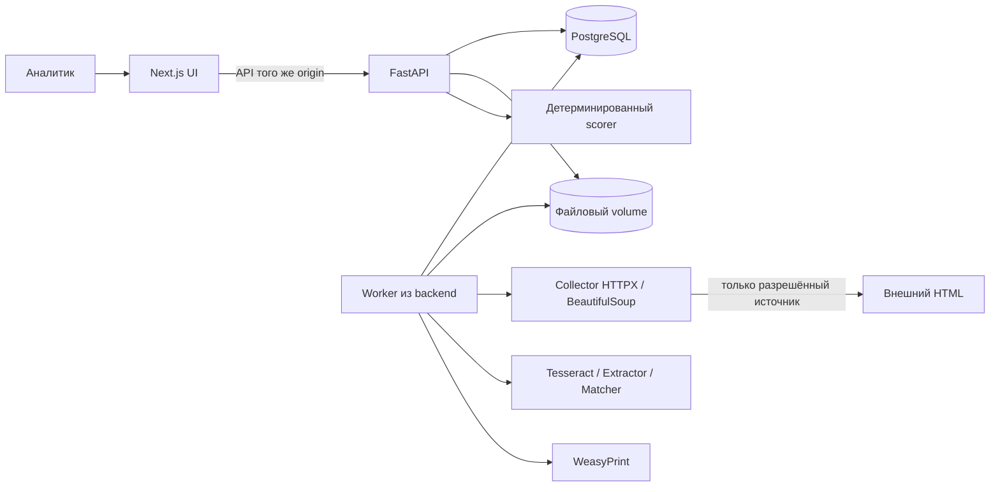

# SAQ QURYLYS — архитектура MVP

Версия 0.1, согласована как основа 14.10.2026. Первый срез реализуется; остальные компоненты ниже — целевая архитектура. Точный статус — PROJECT_STATUS.md. Основание требований — [REQUIREMENTS.md](REQUIREMENTS.md).

## Семь основных решений

| № | Решение | Почему | Цена/ограничение |
|---|---|---|---|
| 1 | Один репозиторий, модульный backend, отдельный worker из той же сборки | Общая модель и транзакции, простой запуск, без микросервисных контрактов | API и worker обновляются совместно |
| 2 | Next.js/TypeScript/Tailwind/shadcn/ui + FastAPI/Pydantic/SQLAlchemy/Alembic + PostgreSQL | Следует профилю CODEX_TZ; SQL-транзакции связывают решение, риск и аудит | Два языка; версии фиксируются при каркасе, без утверждения о готовой сборке |
| 3 | PostgreSQL — очередь заданий и источник бизнес-состояния; файловый volume — оригиналы и PDF | Задачи переживают рестарт, не нужен Redis; файлы не раздувают БД | Нужен lease/recovery и согласованный backup БД+файлов |
| 4 | Tesseract rus+kaz+eng → правила RU/KZ → RapidFuzz → ручная проверка | Содержательный OCR на новом вводе; правила прозрачны; LLM не блокирует P0 | Качество измеряется отдельно; неоднозначные случаи идут человеку |
| 5 | Риск рассчитывает только backend, из подтверждённых фактов, с версией и снимком сигнала | A/B/C воспроизводимы; результат можно объяснить и пересмотреть | Требуются отдельные статусы гипотез, факторов, сигналов |
| 6 | Leaflet и один настраиваемый raster-провайдер; координаты seed вручную | Для восьми объектов достаточно; не нужны 3D/GIS и второй движок | Сеть/условия тайлов; при отказе остаётся реестр; никаких bulk offline tiles |
| 7 | Локальное демо в Linux-контейнерах, серверная идентичность аналитика, изолированный импорт | OCR/PDF имеют системные зависимости; автор решения проверяется сервером | Docker/WSL2 надо проверить; public production и ведомственный SSO отдельны |

Общее архитектурное обоснование — [ADR-001](decisions/ADR-001-mvp-baseline.md). Базовая архитектура принята пользователем; реализация подтверждается отдельно по срезам.

## Компоненты и потоки



UI вызывает API через same-origin proxy. Браузер не обращается к БД, хранилищу или collector напрямую. Backend создаёт job и отвечает 202. Worker получает job из БД, сохраняет исходный материал, затем версии OCR/извлечения/кандидатов. Результат анализа не меняет CONFIRMED-факторы. Analyst review отдельной командой создаёт решение.

При подтверждении фактора backend проверяет доказательства, область/дату, роль и optimistic version; в одной транзакции с блокировкой строки объекта/риска сохраняет событие проверки, обновляет актуальный фактор, пересчитывает риск и добавляет audit_event. Это сериализует и одновременные решения по разным факторам одного объекта. Ошибка откатывает всё. После ответа UI обновляет объект и summary; WebSocket/SSE для MVP не нужен.

Создание сигнала фиксирует снимок текущей версии риска и доказательств. Утверждение требует совпадения версии со свежим состоянием объекта; иначе 409 и новый снимок. Изменения факторов помечают предыдущие сигналы устаревшими для текущего решения, но не меняют их историческое содержимое/PDF. PDF-asset привязывается к снимку и конкретной ревизии решения; PDF черновика после утверждения остаётся отдельным историческим asset, его файл не перезаписывается. GET pdf возвращает файл актуальной ревизии решения, прежние файлы доступны через сохранённые asset-ссылки. Доработка возвращённого сигнала создаёт новую версию через POST signals с previous_signal_id.

## Модель данных

| Сущность | Ответственность и важные связи |
|---|---|
| users, sessions | Локальные учётные записи аналитиков; сервер определяет автора и роль |
| developers | Юридические лица с ролью застройщика/уполномоченной компании/подрядчика; БИН с происхождением |
| properties | ЖК/очередь/корпус: parent_id, level, имя/алиасы, город, адрес, stage, готовность и дата, отдельные latitude/longitude, is_demo |
| legal_bases | Механизм, документ, проверка, применимость во времени; property_id указывает конкретную область, наследования нет |
| advertisements | Публикация, неизменяемый исходный текст, URL/площадка, published_at nullable, captured_at, revision, is_demo |
| advertisement_assets | Сохранённые текст/HTML/изображения, тип, размер, SHA-256, безопасный storage_key |
| extraction_results | Версия pipeline, исходный OCR, исправления отдельной версией, поля с offsets/bbox, решения о гипотезах |
| property_matches | Кандидаты и строковое сходство; отдельная история ручного выбора/отклонения |
| evidence | Ссылка на конкретную версию материала/документа, буквальный фрагмент и даты; R5 — два датированных значения |
| risk_factor_reviews | Решения по кодам R1–R6: статус, область, период, evidence_ids, автор, reason, revision; предыдущие решения сохраняются |
| signals, signal_decisions | Неизменяемые снимки, номера версий/previous_signal_id, решение, PDF-asset и состояние его генерации |
| audit_events | Действие, actor_id, время, объект, old/new revision, причина, request_id; секретов и полного PII нет |
| analysis_jobs | IMPORT_URL / ANALYZE / RENDER_PDF, state, stage, attempt, lease_until, ошибка, idempotency_key |

Схему можно объединять только без потери происхождения и истории. ORM-модели — внутренние; наружу отдельные Pydantic DTO. JSONB допустим для вариативных полей извлечения/снимка, но не вместо ключей/связей и статусов.

UUID для идентификаторов; ISO-8601 timestamps с offset, UTC в БД; отображение Asia/Qyzylorda (+05:00). Unknown даты/координаты остаются null. Денежные суммы передавать десятичной строкой и хранить Numeric, не binary float. Географические поля названы явно, без неоднозначного порядка массива.

## Состояния и инварианты

- Job: QUEUED → RUNNING → SUCCEEDED / FAILED / BLOCKED. BLOCKED означает, например, запрет доступа источника; ERROR не интерпретируется как отсутствие объекта.
- Гипотеза: PENDING → CONFIRMED / CORRECTED / REJECTED. Исправление сохраняет оригинал; смысловая коррекция требует причины.
- Match: PENDING → CONFIRMED / REJECTED. Выбор одного кандидата не подтверждает остальные. Изменение подтверждённой связи требует повторной проверки зависимых факторов.
- Legal verification: UNKNOWN / PENDING / VERIFIED_VALID / VERIFIED_ABSENT / REJECTED. VERIFIED_ABSENT требует материала о проверке применимых механизмов; пустой legal_bases не даёт такого статуса.
- Фактор: UNKNOWN / PENDING / CONFIRMED / REJECTED. Один актуальный статус на property_id+code+оцениваемый период, плюс история. UNKNOWN/PENDING/REJECTED = 0.
- Сигнал: DRAFT → CONFIRMED / RETURNED; новая редакция отдельной записью. PDF generation_state отдельно: NOT_REQUESTED / QUEUED / READY / FAILED.

Нельзя подтвердить R1 одновременно с VERIFIED_VALID для той же области и даты: сервер возвращает 409 и требует разрешить противоречие. Наличие гарантии другого корпуса не создаёт это противоречие. R5 проверяет два evidence и разницу ≥20 п.п.; совпадающие числа другого периода не выдают за сопоставимые без проверки.

Исторический расчёт — по подтверждённым факторам с явным as_of и версией решения. Более поздний правовой документ не стирает прошлый снимок. Отсутствующий период или юридическая неопределённость требуют ручного решения, а не придуманной автоматической даты истечения.

## Надёжность worker

Один worker в MVP. Задание захватывается атомарно в PostgreSQL, сохраняются lease и attempts; истёкший RUNNING восстанавливается без повторного бизнес-эффекта. Новая команда с тем же Idempotency-Key и тем же телом возвращает прежний результат; с другим телом — 409. Повторный анализ создаёт новую версию извлечения, не затирает рассмотренную.

Предлагаемые первоначальные лимиты: 2 попытки для временной сетевой ошибки, 10 секунд connect и 30 секунд чтения, полный job timeout 120 секунд, ограниченный размер ответа. Это технические defaults, не бизнес-нормы; уточнить по измерениям. Нет бесконечных retries и повторов при 401/403/CAPTCHA.

## Безопасность и границы доверия

Для localhost-демо — серверные сессии, password hash, login/logout/me, cookie HttpOnly/SameSite, CSRF token для небезопасных методов и проверка Origin. Автор из сессии; actor_id из request body не принимается. Две роли достаточно: analyst (работа и проверка), viewer (чтение). Второй обязательный проверяющий и ведомственный SSO не заявлены реализованными.

В Compose наружу по умолчанию привязывается только UI к 127.0.0.1; API/БД внутри сети. Public deploy требует отдельной конфигурации TLS, Secure cookies, доступа и хранения; сейчас не выполняется. Нельзя открывать demo-mode с общей идентичностью в интернет.

URL-импорт: allowlist домена и путей, только HTTP(S), запрет credentials и произвольных портов; проверка DNS/всех редиректов, запрет private/loopback/link-local/reserved IP, DNS rebinding учитывается закреплением проверенного адреса при соединении. Прокси из окружения не наследовать без настройки. Копия HTML хранится как данные; не исполнять scripts, не отображать raw HTML в UI. robots.txt — дополнительный технический сигнал, а не единственное доказательство разрешения.

Uploads: PNG/JPEG/TXT для рекламы, PDF для документов; проверка содержимого/MIME, размера ≤10 MB и image dimensions ≤25 MP как стартовые limits; случайный storage_key, вне webroot; запрет traversal и inline active content. OCR — subprocess с timeout и без shell. Файлы доступны через авторизованный endpoint, имена файлов не становятся путями.

PDF: только доверенный server-side шаблон, экранирование текста, локальные шрифты с RU/KZ, custom resource loader без сети и без произвольного file://. Оригинал рекламы не становится HTML/CSS шаблоном WeasyPrint. Логи не содержат секреты, session/CSRF tokens и лишние персональные данные.

Аудит приложения append-only для штатных операций, но администратор БД технически может его изменить. SHA-256 обнаруживает изменение сохранённого файла, не доказывает авторство/законность/судебную допустимость. Production retention, backup/restore и усиление аудита — отдельный этап.

## Структура после согласования

```text
frontend/                  Next.js app, components, API client, browser tests
backend/app/               api, schemas, models, services, worker, configuration
backend/tests/             unit и API/БД integration
backend/alembic/            миграции
contracts/openapi.yaml     согласованный внешний контракт
data/seed/                 синтетические ЖК, объявления и материалы
docs/                      требования, архитектура, UX, приёмка, решения
docker-compose.yml         UI, API, worker, PostgreSQL и volumes
.github/workflows/         проверки и сборка
```

Папки первого среза созданы; worker, uploads, анализ и сигналы ещё не реализованы. Не добавлять универсальные repository/service/adapter-фабрики без конкретной потребности. Небольшие модули предметных сценариев предпочтительнее общего «менеджера».

## Контракт и проверка архитектуры

`contracts/openapi.yaml` — DRAFT. В дополнение к списку CODEX_TZ нужны login/me/CSRF, чтение объявления, результаты/проверка извлечения, документы/доказательства, создание ручных R4–R6, выдача материалов и аудит. Без них UI не завершит проверку на реальном API. Дополнения маркируются x-origin: proposal.

Контракт проверяется до каркаса, затем CI сравнивает с OpenAPI backend. Зависимости/версии и Docker проверяются на реальном окружении при первом вертикальном срезе. Архитектурная схема и API не доказывают, что интеграции запущены.
