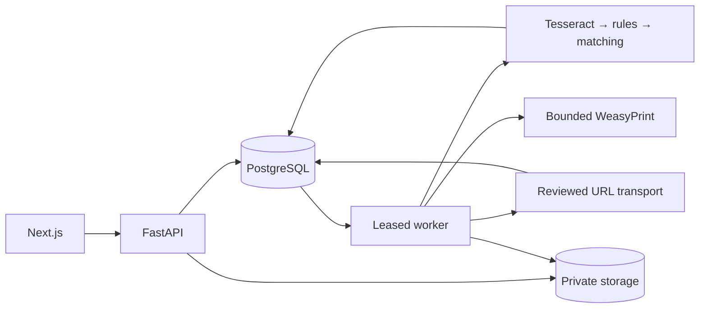

# Архитектура SAQ QURYLYS

## Компоненты

| Компонент | Точка входа | Ответственность |
|---|---|---|
| Frontend | frontend/app/layout.tsx; app/**/page.tsx | RU/KZ UI, формы, state-preserving tabs |
| Proxy | frontend/app/api/[...path]/route.ts | Same-origin API_INTERNAL_URL, cookies, PDF deadlines |
| API | backend/app/main.py:create_app | Сессии, DTO, команды, ревизии, чтение, аудит |
| Worker | backend/app/worker.py | PostgreSQL leases, OCR, URL import, PDF, Telegram queue, URL schedules |
| Схема | backend/alembic/versions/ | Версионные аддитивные миграции |
| Данные | PostgreSQL + private storage | SQL-состояние/история; assets с size/SHA |

Backend и worker используют общие модели/транзакции и один образ. PostgreSQL также служит очередью, отдельный Redis не нужен. Frontend build context — frontend/; backend — корень. Backend image дополнительно читает data/seed, frontend/lib/monitoring-dictionary-v1.json и два versioned docs JSON. Пути связаны с Docker и tests.

## Потоки

1. Материал сохраняет оригинал, nullable published_at, captured_at и provenance. Upload и URL transport имеют server-side bounds.
2. Явная команда создаёт job. Worker использует SKIP LOCKED, claim token и lease; OCR/сеть исполняются вне долгой транзакции.
3. Анализ создаёт версии гипотез и кандидатов, без автоматического подтверждения.
4. Самостоятельные решения человека проверяют exact ID/revision, роль, CSRF/Origin и idempotency key; audit и состояние меняются атомарно.
5. Только CONFIRMED факторы изменяют server risk. Сигнал фиксирует исторический snapshot/ревизию; сохранённый PDF не переписывается.
6. Текущий отчёт досье — отдельное read-only чтение/рендер с whitelist разделов, не замена архивного signal PDF.

## Мониторинг

IMPORT_URL реализован: сервер выбирает source policy, проверяет DNS/IP/redirect/TLS/size/time до соединения. Источники и ограничения — [URL import](FEATURE_URL_IMPORT.md). URL schedules создаются OFF; включение и runs сохраняют историю. Зарезервированный env COLLECTOR_ENABLED не является общим выключателем URL jobs.

Social Monitor разделяет источники, кандидатов, CSV preview/commit, runs, версии профилей/словарей и finding/version/observation. Явный импорт finding создаёт NEW материал с provenance, без auto-analysis/match/risk. Threads имеет отдельный gate доступа. REAL не смешивается с DEMO; недоступный реестр означает WAITING_REGISTRY. Внешняя приёмка и полный P0 остаются открытыми.

## Хранение и безопасность

PostgreSQL — источник состояния/очередь; private storage — оригиналы/PDF. Согласованный backup включает оба компонента. API применяет миграции при старте: перед обновлением нужны backup и проверка схемной совместимости.

Автор и роль определяются серверной session; CSRF/Origin обязательны. Secrets не возвращаются в UI/audit/logs. Assets скачиваются authenticated API. Native Windows не покрывает POSIX limits passive PDF: полный runtime — Linux. OCR/PDF имеют отдельные bounds/deadlines.

## Инварианты

- CONFIRMED R1–R6 считаются один раз; веса 35/25/10/15/10/5.
- Красный ≥60 требует R1+R2; GREEN/0 может содержать unknown.
- Ошибка/отсутствие строки реестра не доказывают R1.
- Правовой документ относится к точному объекту/периоду/области; очереди не наследуют основание по имени.
- OCR, manual proposal, match, evidence, factor review и signal decision — отдельные действия.
- Historical snapshots, источники, авторы/даты и архивные PDF сохраняются.

[Разработка](DEVELOPMENT.md), [API](API.md), [deployment](DEPLOYMENT.md), [ADR](decisions/README.md). Полная прежняя архитектурная хроника сохранена в [архиве](archive/ARCHITECTURE_2026-10-20.md). Независимая RU/KZ/OCR/предметная приёмка, REAL-реестр, live social access, масштабирование/N+1, off-host backup и нагрузочные гарантии этой реорганизацией не закрываются.
