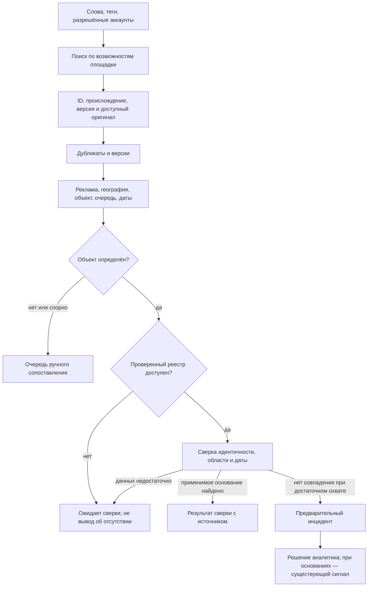

# SAQ QURYLYS — алгоритмы поиска рекламы, сверки и инцидентов

Продолжение 16.10.2026: к CLI добавлен [ручной веб-предпросмотр Threads](FEATURE_THREADS_SEARCH.md) в `/monitoring`, выключенный по умолчанию. Текущий локальный этап заканчивается просмотром одной страницы: найденное ещё не становится Advertisement/кандидатом и не запускает сверку. Live-доступ и весь регулярный поток ниже остаются открыты.

Последующий инженерный шаг 16.10.2026: реализован [ограниченный Threads CLI](FEATURE_THREADS_SEARCH.md) для проверки официального keyword API. Проверены тестовые ответы, живой токен отсутствует. Профили/теги/пагинация/расписание/импорт ещё не реализованы; одноразовый диагностический поиск не заменяет полный алгоритм ниже.

Дата: 16.10.2026, Asia/Qyzylorda. Статус: **PARTIALLY IMPLEMENTED — первый ручной/DEMO-срез реализован, внешний мониторинг PROPOSED**. Текущие API/ограничения — [FEATURE_MONITORING_CASES](FEATURE_MONITORING_CASES.md), решение — [ADR-010](decisions/ADR-010-preliminary-monitoring-cases.md); фактические проверки — [PROJECT_STATUS](../PROJECT_STATUS.md). Последующее поручение пользователя начать реализацию относится к описанному первому срезу; ведомственные правила ещё требуют подтверждения. Основание U: пользователь уточнил целевой сценарий — Krisha, Threads, Instagram, TikTok; поиск по словам и тегам; анализ рекламы; сверка с утверждённым списком; инцидент при отсутствии объекта. Последующее уточнение U: **реестр существует, доступа сейчас нет, доступ ожидается в случае победы в хакатоне**. Это сообщение о будущем доступе, а не уже предоставленный API/выгрузка.

## 1. Главные решения и границы

1. URL-импорт — один из способов поступления материала. Целевой продукт теперь включает регулярное обнаружение публикаций; один GET страницы этот сценарий не закрывает.
2. Инцидент здесь — **предварительная карточка для проверки аналитиком**, с конкретной причиной и источниками. Автоматическое создание такой карточки не подтверждает нарушение и не начисляет R1–R6. Это предлагаемое толкование слова «инцидент»; точное ведомственное действие требует согласования.
3. Сейчас: разрешённый сбор → анализ доступной части материала → очередь кандидатов → WAITING_REGISTRY. Для сквозной демонстрации — изолированные DEMO-публикации и DEMO-список. **REAL никогда не сверяется с DEMO**. Имеющиеся восемь DEMO-объектов не являются утверждённым списком реальных застройщиков.
4. После доступа: приёмка контракта/охвата/актуальности реестра → активация проверенной версии → сверка и предварительные инциденты. Неизвестный формат будущего реестра не заменяем вымышленными endpoint.
5. Сохраняем действующие веса и ручной процесс R1–R6. Наличие гарантии КЖК и применимого разрешения — альтернативные основания в проектной модели; строительная лицензия сама по себе не заменяет их. Отсутствие строки в одном неполном источнике не устанавливает отсутствие всех механизмов.



## 2. Что действительно доступно на площадках

Проверено по официальным публичным материалам 16.10.2026, без реальных API-запросов и сбора рекламы. Описание метода не означает доступ нашего приложения. Полные Meta docs ограничивали чтение; официальная коллекция доступна через поисковый индекс, а прямое открытие части Postman URL вернуло оболочку/not found. Возможности, точные права и квоты подтверждаются коротким live access spike после получения доступа, а не наличием ссылки.

| Канал | Подтверждённая возможность | Что требуется / что не обещаем |
|---|---|---|
| Threads | Официальная Meta-коллекция содержит `/keyword_search`, `q`, `search_type=TOP/RECENT`; перечисляет scope `threads_keyword_search` | Meta app/OAuth и проверка доступа именно к чужим публичным результатам. Точные app-review условия, quota, TAG mode и временные окна в текущем чтении не подтверждены. Первый кандидат для keyword spike, не готовый канал |
| Instagram | Официальное описание **API with Facebook Login** предусматривает hashtagged media; Professional account и связанная Facebook Page | Нужны приложение, token и права на конкретный сценарий. Общий поиск всех чужих captions по словам не подтверждён. Не переносить hashtag-возможности на другой продукт Instagram Login; точные квоты/окна ещё UNKNOWN |
| TikTok | Research Query Videos поддерживает keyword в описании, hashtag_name и условия запроса | Research-доступ отдельный; KZ не перечислен в регионах заявителя, коммерческие пользователи не eligible по FAQ. Это не обещанный доступ команды/регулятора. Индексация новых видео может занимать до 48 часов. Display API — видео авторизованного пользователя, не общий поиск. Commercial Content API не заявляет охват KZ |
| Krisha | Каталог объявлений/новостроек — целевой источник исследования | Условия запрещают автоматическое извлечение без официального разрешения. Нужен согласованный API/экспорт/доступ; документированный general public search API в проверенных материалах не установлен. Robots не заменяет разрешение |

Первичные источники:

- Threads: [поисковый запрос Meta](https://www.postman.com/meta/threads/request/m9j4i2x/search-for-threads-posts), [официальная документация коллекции](https://www.postman.com/meta/threads/documentation/dht3nzz/threads-api), [полные docs, требуют перепроверки доступом](https://developers.facebook.com/docs/threads/keyword-search/).
- Instagram: [Meta API documentation](https://www.postman.com/meta/instagram/documentation/6yqw8pt/instagram-api), [Facebook Login](https://www.postman.com/meta/instagram/folder/9cgqucg/instagram-api-with-facebook-login), [Hashtag Search](https://developers.facebook.com/docs/instagram-platform/instagram-api-with-facebook-login/hashtag-search/). Не фиксируем неподтверждённые численные лимиты как настройки продукта.
- TikTok: [Query Videos](https://developers.tiktok.com/docs/en/research-api-specs-query-videos), [eligibility](https://developers.tiktok.com/products/research-api/), [FAQ](https://developers.tiktok.com/docs/en/research-api-faq), [Display List Videos](https://developers.tiktok.com/docs/en/tiktok-api-v2-video-list), [Commercial Content supported countries](https://developers.tiktok.com/docs/en/commercial-content-api-supported-countries).
- Krisha: [условия использования материалов](https://krisha.kz/content/special/info/copyright), [соглашение](https://krisha.kz/content/special/agreement), [robots](https://krisha.kz/robots.txt). [Kolesa Group об интеграции новостроек с Казреестром](https://kolesa.group/media/posts/products/54-milliona-soobshenij-i-59-millionov-polzovatelej-itogi-2025-goda-krishakz-v-cifrah): это возможность для переговоров об источнике, не контракт доступа и не подтверждение полноты статусов.

Не добавляем обход login/CAPTCHA, выдачу за чужого crawler, аренду личных cookies или неофициальный API с неподтверждённым происхождением. Ручная вставка URL сама по себе не разрешает серверу скачивать материал. Пока API недоступен, допустимы материалы/выгрузка, предоставленные с правом обработки; метод поступления виден пользователю и не называется автоматическим поиском.

## 3. Алгоритм поиска по словам и тегам

### 3.1. Версионный профиль мониторинга

Профиль задаёт регион/города и алиасы, языки RU/KZ, группы слов, теги, конкретные согласованные аккаунты, исключения, дату начала, частоту и лимит запросов. Список городов и расписание пока **UNKNOWN**, для первого запуска предлагаем один согласованный регион. Новые версии профиля не переименовывают причины старых находок.

| Группа | Примеры для настройки, не окончательный словарь |
|---|---|
| География | Өскемен, Усть-Каменогорск, Oskemen, адреса согласованного региона |
| Объект | ЖК, жилой комплекс, ТК, тұрғын үй кешені, новостройки, названия/алиасы ЖК |
| Предложение | старт продаж, купить квартиру, отдел продаж, рассрочка, бронь; сату, бөліп төлеу, бастапқы жарна |
| Теги | #новостройки, #жк, #өскемен, #oskemen и проверенные теги объектов |
| Контекст для отдельной классификации | новости, предупреждение, мошенники, вакансии, ремонт, аренда, вторичная продажа, переуступка |

Планировщик не считает одинаковыми интерфейсы площадок. Слова направляются только в поддерживаемый keyword search; теги — в подтверждённый hashtag search; неподдерживаемые AND/OR и геофильтры выполняются локально над полученной выборкой. Не генерируем бесконтрольное декартово произведение всех слов и городов.

Профиль содержит небольшие query-группы: «новостройки + город», конкретные названия/алиасы, теги. Каждая находка хранит все приведшие к ней query IDs. Для Instagram discovery может идти по тегам, а фильтрация по словам — уже по полученному тексту; это не keyword search всего Instagram.

### 3.2. Инкрементальный обход и покрытие

Для каждого запроса сохраняем cursor, последний успешно обработанный период, ограничения выдачи и способ сортировки. Если источник поддерживает даты, используем перекрывающееся окно с учётом задержки индексации; если нет — повторяем доступную выдачу и дедуплицируем по ID. RECENT предпочтителен для новых находок, если доступен; TOP — дополнительный неполный обзор, не последовательный журнал.

Checkpoint продвигается только после сохранения обработанной страницы. При лимите страниц/квоты запуск PARTIAL, при запрете BLOCKED, при технической ошибке FAILED; это не успешная пустая выдача. Поздно проиндексированные посты принимаются даже с датой раньше последнего обнаруженного поста. Удаление из очередной выдачи не считается удалением публикации.

Бюджет: `запросов в сутки ≈ профили × queries × запусков × среднее страниц + разрешённые перепроверки`. Частоту выбираем после подтверждения квот и доступа, оставляя резерв на retry. 30–60 минут можно рассматривать как пожелание пилота, не SLA и не гарантию свежести платформы. У TikTok Research задержка индексации сама может превышать этот интервал.

### 3.3. Двухступенчатая релевантность

1. Широкое обнаружение по словам/тегам/разрешённым аккаунтам. Не требовать слова «аванс» или суммы: реклама новостройки может продавать без явного платежа в тексте.
2. Локальная классификация доступного материала: `NEW_BUILD_OFFER`, `COMPLETED_PROPERTY_RESALE`, `ASSIGNMENT_OR_RESALE`, `RENTAL`, `NEWS_OR_WARNING`, `NOT_RELEVANT`, `UNCERTAIN`. Предлагаемые типы, не существующие enum API.

Для уверенного нового предложения нужны признаки объекта/продажи/географии без противоречий. Цена и тег сами по себе недостаточны. Вторичная квартира в новом, но уже сданном доме не превращается в подозрение по долевому строительству. Переуступку и неизвестную стадию направляем на отдельную проверку, а не уверенно отбрасываем или обвиняем. Исключения сохраняются с причиной и возможностью исправления аналитиком. Нечитаемый баннер не классифицируем как отсутствие рекламы.

## 4. Сохранение материала, версии и дубликаты

1. Ключ публикации — `(platform, external_id)`; fallback на разрешённый канонический URL только при отсутствии стабильного ID. Удаляем tracking-параметры по правилам конкретной площадки, не весь query произвольно.
2. Храним permalink, query/run, collection_method, original publication time или null, captured_at, разрешённый исходный payload/файл и SHA, версию парсера, ограничения доступа/удержания. Объём хранения соответствует условиям источника; скриншот не заменяет право хранения.
3. Тот же ID и тот же hash — новое наблюдение last_seen, без повторного извлечения **при неизменном ключе анализа**. Тот же ID с новым содержимым — новая версия, история сохраняется. Дедупликация наблюдения не запрещает пересверку при новом реестре, правилах или исправлении связи: ключ анализа — content_version + parser/rules_version + extraction/correction_revision, ключ сверки — analysis_revision + target_resolution_revision + registry_snapshot/coverage_version. Для каждого шага сохраняются ключ и успешный результат; незавершённая попытка не отмечается выполненной. Реестр или исправление связи ставят новую сверку по сохранённому материалу без ненужного повторного скачивания, если его хранение и повторная обработка разрешены.
4. Репост с новым ID — отдельная публикация. Кросс-площадочная похожесть нормализованного текста/изображения создаёт **кандидата в кластер**, не удаляет оригиналы и не объединяет ЖК автоматически. Число репостов не добавляет повторные веса R1–R6.
5. Статусы `NOT_AVAILABLE`, `PRIVATE_OR_DELETED`, `ACCESS_BLOCKED`, `UNKNOWN` различаются, насколько это позволяет API. Подтверждённое исчезновение не удаляет сохранённое доказательство автоматически: правила хранения/удаления определяются договором и политикой площадки. Если удержание запрещено, контролируемо удаляем/редактируем файл с аудитом и пометкой недоступного доказательства, не обещаем вечный архив.

## 5. Извлечение и разрешение идентичности объекта

Доступный caption/текст → существующие RU/KZ правила; разрешённые изображения → существующий OCR. Извлекаем название/алиасы, город/адрес, корпус/очередь, компанию/БИН при наличии, стадию, условия оплаты/сумму, заявленные номер/дату документа, дату публикации. Каждое поле имеет исходный фрагмент, метод/версию и статус проверки; отсутствующее поле остаётся неизвестным.

Видео — **новый будущий scope**, сейчас не реализован. После получения прав на файл: ограниченный sandbox → ключевые кадры и дополнительные кадры по времени в пределах бюджета → OCR с временными отметками; разрешённая аудиодорожка → ASR с временными отметками; объединение с caption с сохранением происхождения. Разреженная выборка кадров не гарантирует обнаружение всех надписей. Первый MVP может анализировать только caption/изображение, но обязан явно показывать `TEXT_ONLY`/`VIDEO_NOT_ANALYZED`, а не «видео полностью проверено». TikTok keyword в описании не означает поиск по всему содержимому ролика.

### 5.1. Кандидат должен существовать независимо от утверждённого каталога

Текущий `match_candidates` перебирает только имеющиеся properties. Если рекламируемого объекта нет в нашем каталоге, этот matcher не может создать его. Нужен самостоятельный кандидат найденного объекта: извлечённое имя/адрес/очередь и связанные публикации, без вымышленного БИН/застройщика. `property_id` может отсутствовать; `candidate_object_id` сохраняет маршрут проверки. Нельзя автоматически заводить подтверждённый Property и фальшивого Developer ради обязательного FK.

### 5.2. Сопоставление — правила до нечёткого сходства

1. Нормализовать RU/KZ регистр, Unicode, адресные сокращения и известные алиасы. Диакритику и транслитерацию использовать для расширения кандидатов, сохраняя оригинал; не считать все разные написания одним объектом.
2. Сузить кандидатов городом/адресом/БИН/идентификатором документа, когда они известны. БИН застройщика не уникален для ЖК и корпусов.
3. Проверить точную очередь/корпус и область документа. Конфликт города, адреса, БИН или корпуса запрещает уверенное сопоставление даже при одинаковом названии.
4. Строковое сходство названий выдаёт top-3 с объяснением. Оно не является вероятностью и не доказывает наличие разрешения. Название без второго идентификатора не должно автоматически проходить в «разрешение найдено».
5. Предварительная идентичность `PROVISIONAL` возможна при согласованных нескольких идентификаторах, например имя/алиас + точный адрес + очередь. Она позволяет автоматическую сверку и предварительную карточку **без обязательного предварительного нажатия аналитика**; извлечённая идентичность явно помечается непроверенной. Окончательная `CONFIRMED` связь для доказательств и существующего R1/Signal подтверждается человеком, как в текущем MVP. Название без второго идентификатора и конфликтующие данные не дают PROVISIONAL только ради автоматизации. После доступа можно отдельно согласовать точное сопоставление реестрового ID, проверив контракт и качество на размеченном наборе.
6. Одинаковые названия разных ЖК и реклама нескольких корпусов дают AMBIGUOUS/MULTIPLE_TARGETS. Одну запись с несколькими очередями не сравниваем с произвольной первой строкой; создаём отдельные области проверки после подтверждения аналитиком.

Не вводим произвольные «90% уверенности» без размеченной выборки. Приоритет очереди можно задавать объяснимыми признаками: прямой платёж, повторная публикация, конфликт документа; это отдельная организация работы, не новая формула риска R1–R6.

## 6. Реестр и алгоритм сверки

### 6.1. Контракт, который потребуется после предоставления доступа

Нужны идентификатор/издатель записи, тип основания, номер/дата документа, БИН и роль компании, объект/адрес/город/очередь/корпус, статус и известные периоды действия, дата обновления. Для всего набора — дата актуальности, географический и предметный охват, включены ли гарантии и применимые разрешения, полнота, правила исправления и удаления. Реальный формат, endpoint/auth/лимиты, возможность истории и bulk/delta — пока UNKNOWN.

Каждая принятая версия набора сохраняется с происхождением/hash и состоянием `RECEIVED → VALIDATING → ACTIVE` либо `REJECTED`. Частичный/пустой ответ вследствие ошибки не заменяет рабочую версию. Для delta требуется явный контракт удаления и последовательности; отсутствие в очередной delta не означает исключение из реестра. Секреты доступа не входят в snapshots.

### 6.2. Таблица решений

| Ситуация | Результат | Действие |
|---|---|---|
| Реестра/доступа сейчас нет | REGISTRY_UNAVAILABLE | Кандидат WAITING_REGISTRY; общая видимая проблема источника, без тысяч одинаковых «нет разрешения» |
| REAL материал + DEMO список | MODE_MISMATCH | Сверку запретить, исправить выбор данных |
| Реклама не относится к целевому сценарию | NOT_APPLICABLE / UNCERTAIN | Причина исключения либо ручная проверка |
| Неясный ЖК/корпус или конфликт идентификаторов | ENTITY_AMBIGUOUS | Ручное сопоставление, отсутствие совпадения не считать установленным |
| Применимое основание найдено на нужный объект/дату | MATCHED_APPLICABLE_RECORD | Показать конкретный документ/область/дату/версию; это не гарантия отсутствия других рисков |
| Нет совпадения при подтверждённых области, актуальности и достаточном охвате | NO_MATCH_IN_APPROVED_SNAPSHOT | Автоматически открыть/дополнить **предварительный** инцидент; отсутствие применимого основания ещё проверяет специалист |
| Запись есть, но другая очередь/дата/статус | RECORD_SCOPE_OR_STATUS_CONFLICT | Предварительная карточка с конкретным расхождением и документами |
| Набор частичный/устарел, нет нужного механизма, неизвестна относящаяся дата | COVERAGE_OR_DATE_UNKNOWN | WAITING_DATA, не отрицательный результат |

Сверка выполняется на относящуюся дату рекламы, а не только «сегодня». Если известен лишь календарный день, не выдумываем точное время 00:00. Если доступен только текущий список, не делаем из него вывод о прошлом. Текущие строгие guards R1/R2 и датированные ручные процедуры сохраняются; изменение временной модели — отдельное предметное решение.

Псевдокод **будущего** обработчика, не существующая функция/API:

```text
process(observation):
  version = save_or_observe_idempotently(observation)
  analysis = reuse_or_run_analysis(version, parser_rules_and_correction_revision)
  if analysis.uncertain: enqueue_manual_review(); return
  if analysis.out_of_scope: save_exclusion_reason(); return
  target = resolve_or_reuse_candidate(analysis, target_resolution_revision)
  if target.ambiguous: enqueue_entity_review(); return
  snapshot = current_approved_snapshot(mode, region)
  if snapshot unavailable: mark_waiting_registry(); return
  if snapshot.mode != version.mode: reject_comparison(); return
  key = (analysis.revision, target.revision, snapshot.id, snapshot.coverage_version)
  if successful_comparison_exists(key): return
  result = compare_scope_dates_and_identifiers(target, snapshot)
  persist_comparison_with_version_and_explanation(result)
  if result is NO_MATCH_IN_APPROVED_SNAPSHOT or RECORD_SCOPE_OR_STATUS_CONFLICT:
      upsert_active_preliminary_incident(target, rule_code, observations, result)
  else if result is UNKNOWN:
      enqueue_missing_data_review()
  else:
      propose_resolution_of_related_incident_if_any()
```

## 7. Инцидент, дубликаты и изменения

Предлагаемые состояния: `OPEN → IN_REVIEW ↔ WAITING_DATA → CLOSED`; причина закрытия отдельна: MATCH_FOUND, NOT_APPLICABLE, DUPLICATE, SIGNAL_CREATED. Автор, время, обоснование и переходы аудируются. Инцидент может ссылаться на кандидата объекта до создания полноценного Property. Существующий Signal с обязательным property_id и неизменяемым snapshot не используем как изменяемую очередь находок.

Ключ активной карточки — `(mode, canonical_candidate_id, target_scope, rule_code)`. Нужен DB uniqueness для активных состояний и атомарный upsert. **registry_version и каждый post ID не входят в ключ инцидента**, иначе новая выгрузка/репост будет создавать дубли; они добавляются как наблюдения/сравнения. После закрытия новое существенное событие может открыть новый эпизод по отдельно зафиксированной политике.

Переход к подтверждённому Property не меняет каноническую идентичность кандидата. Если два кандидата оказались одним объектом, аналитик подтверждает merge: в одной транзакции блокируются обе идентичности, выбирается canonical ID, сохраняется redirect/alias; активные карточки той же области/причины объединяются с DB uniqueness, исходная закрывается как DUPLICATE со ссылкой на оставшуюся. Происхождение наблюдений и исторические comparisons с исходными ID не переписываются; новая сверка учитывает revision объединения. Совпадение одного fuzzy-названия не запускает merge, REAL/DEMO не объединяются. Обратное исправление ошибочного объединения — auditable split и пересверка связанных карточек, без удаления истории.

В карточке: причина «не найден в версии списка…», режим DEMO/REAL, источник и permalink, известная дата публикации/получения, объект/очередь/неопределённость, признаки рекламы и оплаты с фрагментами, реестровая версия и охват, найденные конфликтующие документы, материалы кластера, ответственный, история и следующее действие. Нет ярлыка «мошенник» или «разрешения точно нет» от одного отрицательного поиска.

Повторный анализ запускается при изменении публикации, исправлении OCR/объекта, новой версии правил или относящейся версии реестра/статуса/даты применимости. Последний результат не заменяет историческую сверку. Новая запись реестра предлагает закрытие предварительного инцидента; противоречие ранее подтверждённому фактору требует отдельной проверки специалистом, старые сигналы/PDF не переписываются.

Telegram в будущем сообщает один новый предварительный инцидент и согласованные существенные изменения с event ID/дедупликацией. Текущий бот отправляет только новые ручные CONFIRMED-факторы; для incident events нужен отдельный явный event type и текст «требует проверки». Не подменяем инцидент созданием фиктивного R1 ради существующего уведомления.

## 8. Изменения относительно реального кода

| Уже есть | Путь | Что потребуется дополнить |
|---|---|---|
| Ручные публикации и оригиналы/SHA/DEMO | `backend/app/api/advertisements.py`, `uploads.py`, `storage.py`, models Advertisement/Asset | Platform ID, наблюдения и версии публикаций, права/ограничения источника |
| Защищённый HTML transport без подключения | `backend/app/url_fetcher.py`, [ADR-008](decisions/ADR-008-bounded-url-transport.md) | Разрешённый source adapter; API OAuth/media не реализовывать как произвольный HTML GET |
| Worker, leases, повтор/идемпотентность | `backend/app/worker.py`, `api/analysis.py` | Запуски поиска/checkpoints, quota/backoff, отдельная учётная сущность системного запуска; безопасное разделение очереди сбора и пользовательских действий |
| OCR RU/KZ, rules-1.3, top-3 по имеющимся properties | `backend/app/extraction.py`, `ocr.py` | Релевантность/адреса/БИН/документы, кандидаты отсутствующих объектов, только затем видео/ASR |
| Датированные LegalBasis и ручные R1–R6 | `backend/app/legal.py`, `api/legal_bases.py`, `api/reviews.py` | Версионные реестровые записи/покрытие и журнал сравнений; не заменять человеческий VERIFIED статус raw импортом |
| Сигналы/PDF, аудит, история | `backend/app/api/signals.py`, models Signal/AuditEvent | Отдельный preliminary incident lifecycle и связи, затем существующий сигнал по решению человека |
| Telegram outbox | `backend/app/notifications.py`, models TelegramNotification | Тип incident event и его dedup/снимок; текущая таблица привязана к factor_id/revision |

Для MVP достаточно нынешнего FastAPI/PostgreSQL/worker/storage: не требуются Redis, Kafka, микросервисы или своя ML-модель. Новые persisted concepts действительно нужны для задачи: мониторинговые профили/запуски/наблюдения, кандидат объекта, реестровые версии/сравнения, preliminary incidents. Точное число таблиц/DTO определяется перед реализацией; эта записка не является миграцией, OpenAPI или выбранным контрактом будущего госреестра. При вводе scheduler/machine actor/нового retry или OAuth оформить соответствующий ADR, пока решение PROPOSED.

Границы интеграции: API/OAuth secrets только на сервере, минимальные scopes, ротация/отзыв и редактирование token-bearing URL перед логированием. Сохраняется только разрешённый payload, без secrets из заголовков/временных ссылок. Разрешённые media CDN и redirects проверяются отдельно с теми же SSRF/лимитами; URL из поста не получает автоматическое разрешение на скачивание. Доступ к оригиналам/инцидентам — через роли приложения. Если позже используется LLM, текст публикации считается данными: инструкции из него не исполняются, автоматические внешние сообщения/юридические решения ему не поручаются. Новые service actors/админские операции не открываются публично ради демонстрации.

## 9. Этапы и критерии готовности

1. **Контур алгоритма без внешних доступов:** согласовать регион и смысл инцидента; размеченные DEMO-публикации/DEMO-реестр, независимый кандидат объекта, три исхода сверки, dedup и ручная проверка. Материалы вводятся существующим ручным путём либо будущим явным импортом предоставленного файла; это ещё не live мониторинг.
2. **Один реальный канал:** сначала access spike Threads (либо согласованный экспорт Krisha/партнёра). Реальный разрешённый результат по запросу → сохранение происхождения → повторный запуск без дубля → блокировка/квота отображаются корректно. Выбор канала определяется фактическим доступом, не названием API в плане.
3. **Регулярный поиск и инциденты на DEMO:** профили, расписание, ограниченные окна/бюджеты, воспроизводимые сравнения и одна карточка на объект/причину. Реальные находки без реестра остаются WAITING_REGISTRY; не смешиваются с DEMO-демонстрацией.
4. **Другие площадки:** Instagram hashtag spike; Krisha по согласованному доступу; TikTok по подходящему разрешённому пути. Каждый канал отдельно проходит проверку полномочий, покрытия, сохранения и ошибок. Не обещать все четыре live-канала к 21 октября без этих проверок.
5. **После победы/доступа:** обследование реестра, проверка контракта и версий, независимый эталон сопоставления, включение реальной сверки и ведомственная приёмка. Подключение реестра не означает автоматическое получение доступов Meta/TikTok/Krisha.

Минимальные проверки будущего алгоритма:

- ЖК в списке, правильная очередь/дата → найдено; одинаковое имя в другом городе → не автосопоставлять.
- Гарантия есть, отдельного разрешения МИО нет → не создавать «нет основания» только из-за отсутствия разрешения.
- Нет совпадения при пригодном полном DEMO-наборе → один preliminary incident, R1/баллы не появляются.
- Реестр недоступен/неполон/устарел или дата неизвестна → WAITING, не отрицательный вердикт.
- REAL+DEMO → отказ; номер документа есть, но иной БИН/очередь → конфликт на проверку.
- Вторичное/сданное жильё, новости и предупреждения → отдельная классификация; сомнения сохраняются.
- Та же публикация найдена по трём тегам и на повторном запуске → один post/version; новый контент → новая версия.
- Репосты на разных площадках → отдельные источники, один подтверждённый объект/активная причина без повторных весов.
- 429, истёкший token, 403/CAPTCHA, crash после сохранения страницы → backoff/blocked/recovery, без выдуманной пустой выдачи и потери checkpoint.
- Поздний пост, удалённый пост, новая реестровая версия, исправленная связь → воспроизводимый пересмотр с историей.
- Caption обработан, видео недоступно → явное неполное покрытие; фрагмент/временная отметка ведёт к настоящему сохранённому источнику.

Метрики: точность релевантной рекламы и recall на размеченном доступном наборе; precision/top-3 сопоставления и доля неоднозначных; ложные preliminary incidents; дедупликация и задержка от доступности данных, а не обещание мгновенного поиска с момента публикации. Отдельно показывать квоты/покрытие и долю необработанных видео. Численные пороги установить на эталонной выборке с заказчиком; не переносить 100% прежнего synthetic OCR regression на этот новый мониторинг.

## 10. Открытые решения

- Точный регион, перечень ЖК/аккаунтов, языки и нужная глубина истории/частота.
- Доступы к приложениям площадок и сторона, которая сможет получить согласованный экспорт Krisha.
- Достаточен ли для первой защиты текстовый анализ, либо обязательно полное видео; это разный объём и права на материалы.
- Ведомственный смысл инцидента/ответственный/срок реакции и политика повторного открытия; предложен предварительный внутренний case.
- Контракт, полнота и временная модель закрытого реестра: до предоставления доступа остаются неизвестными. Недоступность реестра уже установлена пользователем; повторно требовать ключ для текущего проектирования не нужно.

## 11. Первый связный блок реализации после согласования проекта

Предлагаем **сначала работающий алгоритм сверки и предварительных карточек на DEMO**, с границами, которые затем используют реальные источники. Это позволяет показать основной результат без выдуманного доступа и не привязывать бизнес-логику к HTML одной площадки. Параллельно можно обследовать доступ одного канала, но реальный контент не переносится в DEMO.

| Пакет | Конкретный результат | Проверка завершения |
|---|---|---|
| 1. Предварительная карточка и кандидат | Отдельный кандидат без обязательного Property/Developer, предварительный case, причина/режим/наблюдения/автор/история, OPEN/IN_REVIEW/WAITING_DATA/CLOSED | Неизвестный объект сохраняется; два запуска не создают две карточки; роли/ручное закрытие/возврат из ошибки проверены; R1/Signal автоматически не создаются |
| 2. DEMO-версия реестра и сравнение | Явно помеченная синтетическая версия, идентификаторы/область/период/полнота; MATCH/NO_MATCH/UNKNOWN, журнал ключей сверки | Два похожих ЖК/две очереди различаются; гарантия не теряется; REAL+DEMO запрещено; новая версия реестра пересверяет неизменную публикацию и сохраняет прежний результат |
| 3. Один разрешённый источник | Подтверждённый доступ, query-профиль, сохранение разрешённых ID/текста/происхождения, checkpoints/429/backoff/отзыв доступа | Настоящая выдача проходит в REAL-кандидата WAITING_REGISTRY, повтор без дубля; PARTIAL/BLOCKED видны; доказаны пределы и метод сбора |

Для первого DEMO-показа подготовить минимум шесть случаев: найдено применимое основание; нет записи; совпало имя, но другой город; разрешение только соседней очереди; список устарел/недоступен; десять повторных находок одного объявления. Все фиктивные значения и документы помечаются DEMO. Успех DEMO-контура не закрывает live C-01, реестровую интеграцию и внешнюю приёмку.

Первый UI использует существующие таблицы/состояния/навигацию проекта: очередь найденных материалов с причинами, отдельная карточка проверки, панель доступности источников. Перед frontend-реализацией обязательно сверить дизайн-систему/UX/компоненты и провести привычные responsive/accessibility/browser проверки. Эта записка не является визуальной приёмкой и не вводит новую дизайн-систему.
