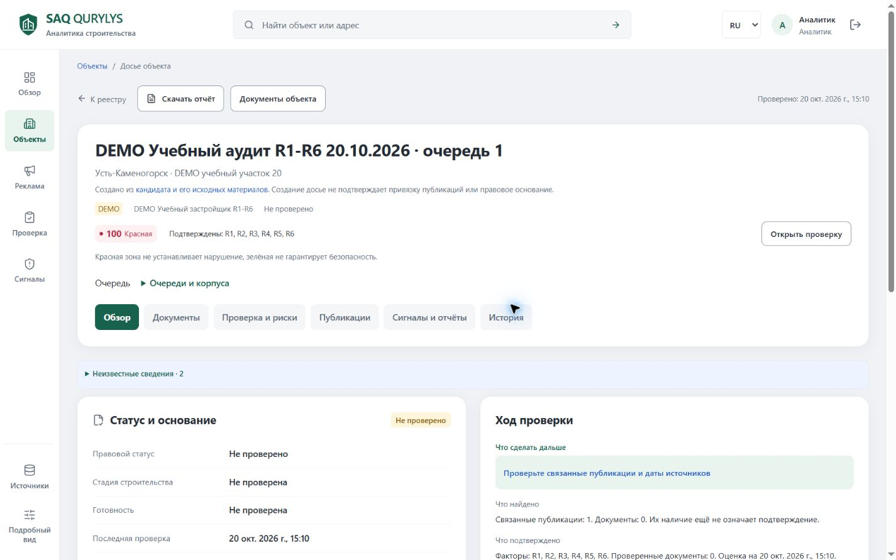
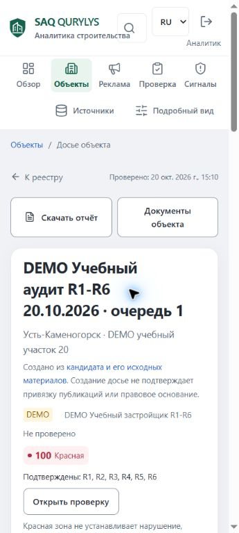

# SAQ QURYLYS — продуктовый и UI/UX-аудит

Дата завершения: 20.10.2026, Asia/Qyzylorda. Исполнитель: Codex.

**Вердикт:** реализован рабочий аналитический MVP с настоящими решениями человека, историей и PDF. Демонстрационная HTTPS-установка доступна. Основной недостаток — непоследовательная передача смысла доказательств из материала в исторический сигнал и экспорт. Коммерческая зрелость и независимая предметная приёмка не подтверждены.

**Результат исследования: 15 проблем — P0: 0, P1: 5, P2: 9, P3: 1.** Отсутствие доказанного P0 относится к проверенному объёму, а не ко всем возможным состояниям. Исправления в рамках аудита не выполнялись.

## Объём, версия и доказательства

Завершено прерванное задание «CODEX UI/UX ROAST & FULL PRODUCT AUDIT», включая разделы A–N. Исследована локальная ветка codex/audit-workflow-fixes, база b15608664f271367b3cc63505def5041f1c69117 плюс существующий накопленный diff. HEAD сам по себе не идентифицирует установленную версию. Сохранённая предыдущим этапом сверка 449 SHA подтверждает совпадение локальных исходников с финальным deployment manifest; повторная проверка приведена в приложении валидации. Это не независимое перечитывание remote filesystem.

Исследованы AGENTS, README, PROJECT_STATUS, CODEX_TZ, REQUIREMENTS, ARCHITECTURE, API-контракт, актуальные ADR/feature docs, frontend/backend, миграции, существующие тесты и исходные результаты проверок. Контекст кейса и исследования сверялся с материалами предыдущего requirements audit. При оценке интерфейса применён установленный ui-ux-pro-max: поиск error recovery feedback; рекомендации сверены с проектными DESIGN_SYSTEM/UX_GUIDELINES. Новый дизайн, библиотека и master не создавались.

Типы доказательств:

- **runtime** — наблюдение опубликованного UI или выполнение проверки в изолированной среде; конкретная среда всегда указана.
- **code** — путь выполнения и условие подтверждены текущими исходниками, но пользовательский эффект мог не воспроизводиться на сервере.
- **hypothesis** — обоснованное предположение об удобстве или скорости, требующее измерения.
- **unverified** — проверка не проведена или условия недоступны. Это не отрицательный результат теста.

Исторические receipts не выдаются за новые прогоны. FACT — установленный факт; ASSUMPTION — экспертное предположение; UNKNOWN — отсутствующее подтверждение; CONFLICT — расхождение представлений или документов.

Свежий браузерный обход: опубликованный HTTPS-сайт, существующая сессия analyst; обзор, реестр/карта, DEMO-досье, диалог отчёта, реклама, очередь проверки, сигналы, источники и Parser V2. Открытие диалога, вкладок и выбор метки не создавали материалы, решения или задания. Формы записи, новый OCR и выгрузка PDF в этой сессии на рабочей БД не выполнялись. Чужая вкладка была занята предыдущей сессией; создана отдельная временная вкладка, обход завершён. Временный viewport сброшен.

Досье и диалог проверены на 360×800, 390×844, 768×1024, 1024×768, 1440×900 и 1920×1080. Карта дополнительно проверена на 390×844 и 1440×900. Основные разделы просмотрены на 1440×900. Полная матрица всех страниц, состояний и ролей на всех шести размерах не выполнена. Измерения: [досье](assets/product-audit-completion-20261020/responsive-dossier.json), [диалог](assets/product-audit-completion-20261020/responsive-dialog.json), [маршруты](assets/product-audit-completion-20261020/routes-readonly.json).

Основные источники доказательств:

| Материал | Что подтверждает | Что не подтверждает |
|---|---|---|
| [Реестр проблем](SAQ_QURYLYS_UI_UX_ISSUES_2026-10-20.md) | Все 15 условий, пути/строки, последствия и рекомендации | Исправление или приёмку предложенных решений |
| .local/product-audit-20261020/validation/VALIDATION_SUMMARY.md | Предыдущий этап этого аудита: 199 PASS/8 FAIL/3 SKIP, воспроизводимость порядка, 17 presentation PASS, статические проверки, 89/89 API routes | Полный зелёный suite и native Linux renderer |
| [R1–R6 analyst acceptance](R1_R6_ANALYST_ACCEPTANCE_2026-10-20.md) | Предыдущий настоящий DEMO UI/API путь, отрицательные проверки, версии сигналов и скачанные PDF | Достаточность реальных юридических оснований |
| .local/v2-ui-20261020/journey/result.json | Настоящие API/worker/human decisions после синтетической выдачи источника | Live discovery: external_search=NOT_RUN |
| .local/oracle-deploy-20261020/public-acceptance/result.json | Предыдущая public TLS/auth/files/PDF/restart acceptance | Нагрузочную готовность и свежую полную регрессию |
| .local/oracle-deploy-20261020/server-backup-restore.json | Проверенное восстановление 37 таблиц, 68 файлов и 3 исторических PDF | Автоматическое резервное копирование по расписанию |
| [Приложение валидации](SAQ_QURYLYS_UI_UX_VALIDATION_2026-10-20.md) | Новые команды, результаты, границы и final source parity | Независимую пользовательскую/правовую приёмку |

## A. Product Reality Check

### Фактический продукт

Frontend: Next.js 16.4.0, React 19.3.1, TypeScript, Leaflet, собственные semantic CSS tokens, Tailwind/PostCSS и небольшие компонентные utilities. Backend: FastAPI, PostgreSQL, SQLAlchemy/Alembic, worker, Tesseract RU/KZ, правила извлечения и RapidFuzz. Стек установлен по package/config/code, а не по старому описанию.

Пять основных рабочих зон — Обзор, Объекты, Реклама, Проверка, Сигналы. Источники — дополнительный вход; сравнение и мониторинг вложены в проверочный маршрут. Досье имеет шесть настоящих вкладок. Они сохраняют контекст; это не переименованные якоря одной длинной страницы. Источники: [workspace.tsx](../../frontend/components/workspace.tsx), [monitoring-workspace.tsx](../../frontend/components/monitoring-workspace.tsx), [frontend package](../../frontend/package.json), [ARCHITECTURE](../ARCHITECTURE.md).

| Возможность | Реальное состояние | Подтверждение и граница |
|---|---|---|
| Реестр, фильтры, пагинация, поиск | Реализовано | Название, адрес, aliases, застройщик/БИН; серверный work_priority по всему набору до pagination: [properties.py:17](../../backend/app/api/properties.py#L17), :44–96. Карта и список открыты live |
| ЖК/очереди/корпуса | Реализована сохранённая структура | Parent/child/sibling: [properties.py:129](../../backend/app/api/properties.py#L129). Риск/документы автоматически не наследуются. Полнота реальных связей не принята |
| Текст, изображение, CSV, разрешённый URL | Реализовано | Оригинал, даты, SHA, preview/validation/dedup; CSV и новый материал раньше проходили настоящий isolated journey. В текущем обходе запись не повторялась |
| OCR и извлечение RU/KZ | Реализовано с ограничениями | Исходный OCR/ручная расшифровка/фрагменты/гипотезы разделены. Ранее server RU/KZ synthetic smoke PASS; независимая точность реальной рекламы UNKNOWN |
| Предложение и проверка ЖК | Реализовано | Кандидат → новое досье либо связь с существующим → отдельная привязка публикации. Есть история и отмена ошибочной LINKED. Полный semantic matching по всем реквизитам не заявлен |
| R1–R6 и решения | Реализовано | Только уникальные CONFIRMED; веса 35/25/10/15/10/5; RED ≥60 при R1+R2. В UI/API DEMO проверены подтверждения, отклонения и история. Это не заключение о реальных компаниях |
| Сигналы, решения, архивный PDF | Реализовано | Snapshot/версии/устаревание/решения/read-only GET; архивные bytes не переписываются. Представление временного контекста имеет SQ-01–03 |
| Текущий отчёт досье | Реализовано | Разделы/язык/обязательная сводка/ошибка/отмена. Предыдущие native RU/KZ 41-page downloads PASS; client timeout SQ-05 остаётся |
| Коммерческий URL collector | Узко реализовано | AN GROUPS /payment, HTML/text/source/SHA/job/recovery. Также отдельный информационный Primeminister importer. Это не обход всех площадок |
| Регулярное получение URL | Реализовано для точных разрешённых URL | Явное включение, лимиты, история/backoff; не равно поисковому scheduler соцсетей |
| Parser V2 | Реализован значительный технический путь | Словарь/активации/версии профиля → один keyword run → capture/findings/query observations → TEXT_ONLY import → обычная проверка. UI открыт на Oracle. Предыдущий E2E использовал SYNTHETIC_DEMO_QA_FIXTURE |
| Полный Social Monitoring V2 | Частично | Нет принятого live Threads доступа, общего многоплатформенного collector, пагинации/hashtag execution/search scheduler; finding-level ручные priority/false-positive/resolution и полный editor не закрыты |
| Реестр оснований | Частично/внешне недоступно | Операторские документы и PDF КЖК есть; полный авторитетный REAL-реестр не подключён. WAITING_REGISTRY не означает отсутствие основания |
| Telegram | Реализована очередь, выключен на сервере | Свежая внешняя доставка не выполнялась; существование модуля не доказывает активный канал |
| RU/KZ интерфейс | Частично | Переключатель/сохранение контекста есть; authored map/date/options местами RU: SQ-09 |
| Публикация и восстановление | Demo technical acceptance выполнена ранее | Oracle HTTPS, отдельная VM, restore receipts. Micro — небольшая демонстрация, не load/production acceptance |
| Независимая приёмка | Не завершена | Реальный holdout RU/KZ, 3–5 пользователей, предметный эксперт, второй физический ПК, freeze/CI/сдача exact revision |

### Данные и недоступные функции

В свежем обзоре показаны 26 объектов и 50 материалов. Из них шесть материалов отмечены DEMO; карточка учебного объекта явно маркирована DEMO. Эти числа — состояние прочитанной установки, не показатель полноты рынка. Реальные карточки с 0/GREEN показывают «Основание не проверено», отсутствие подтверждённых факторов и оговорку о неполноте.

На сервере источник Threads показывает «Выключен / Токен не настроен». V2-профили/находки в просмотренном состоянии пусты; интерфейс объясняет, что это не доказательство отсутствия рекламы. Instagram/TikTok обозначены без автоматического коннектора. Полный государственный реестр, скрытые разрешительные API и массовый соцмониторинг не подтверждены.

**CONFLICT документации:** часть feature/checklist ещё говорит «не установлен» без разделения local primary и Oracle. Аудит 19.10, где отсутствовали V2 findings/import/UI, устарел по этому пункту. Исторические записи сохранены; свежий результат определяется текущим кодом, верхним deployment status и receipts. Это документационный риск поставки, не шестнадцатый продуктовый дефект.

Нельзя заявлять: «AI устанавливает нарушение», «зелёный означает безопасно», «все соцсети мониторятся», «госреестр подключён», «все финальные тесты зелёные», «продукт принят специалистами». Текущий UI во многих местах честно ограничивает эти утверждения; тотальное вводящее в заблуждение обещание в нём не обнаружено.

## B. Brutal Roast

1. **Аккуратная карточка теряет точность при экспорте.** Если публикационная дата неизвестна, переносимое evidence может назвать дату фиксации «событием». Для аналитического инструмента смысл даты важнее визуального спокойствия шапки — SQ-01.
2. **Историческое основание выглядит определённее, чем есть.** Период применимости и дата проверки сохранены, но не доходят до всех представлений сигнала/PDF — SQ-02.
3. **PDF не выдерживает собственную дисциплину UNKNOWN.** UI объясняет неизвестные факторы, а исторический экспорт 0/GREEN может не раскрыть все отсутствующие R1–R6 — SQ-03.
4. **Человек назначен ответственным, но не имеет полного инструмента исправления.** Если extractor не создал PAYMENT_TERM, подтверждать нечего; повторная расшифровка запускает те же правила — SQ-04.
5. **Серверу разрешили работать дольше, чем ждёт пользовательская кнопка.** Client abort25s конфликтует с server/proxy60/75s — SQ-05. Смена текста кнопки это не исправит.
6. **Сводка шести факторов иногда складывается в семь.** PENDING учитывается ещё раз как unknown. Расчёт балла корректен, но доверие к соседним числам страдает — SQ-06.
7. **Внешне спокойное досье может быть не обновлено.** После failed GET остаются предыдущие данные без соответствующего предупреждения — SQ-07.
8. **Вкладки организуют экран лучше, чем загрузку.** Secondary effects стартуют заранее; лишние запросы доказаны, реальное замедление ещё нужно измерить — SQ-08.
9. **RU/KZ не закончено на уровне авторских подписей.** Русская дата и подписи карты остаются в казахской оболочке — SQ-09. Оригинальные документы переводить при этом не следует.
10. **Документы предлагают искать в двух пересекающихся списках.** Фильтр действует на один из них, создавая неоднозначную область поиска — SQ-10; влияние на людей пока гипотеза.
11. **Ответственность приходится разыскивать отдельно.** Автор проверки не выведен рядом с каждым результатом, хотя соответствующие поля существуют — SQ-11.
12. **Рабочая очередь обещает действия, которые уже недоступны.** Счётчик DRAFT включает stale версии; предметное решение по ним защищённо отвергается — SQ-12.
13. **«Источник не указан» может означать лишь «не попал в последние100событий».** Это неверное объяснение ограниченного чтения, а не установленная потеря данных — SQ-13.
14. **Размеры важных действий не имеют ясной общей шкалы.** Наблюдались40–42px при проектном ориентире44px — SQ-14. Это локальная консистентность, не доказанное нарушение WCAG AA.
15. **Регрессии слишком зависят от порядка очереди тестов.** Legal assertions могут падать из-за оставшегося PDF job; отдельный продуктовый legal дефект этим не доказан — SQ-15.

Не обнаружено оснований объявить карту декоративной заглушкой, весь frontend макетом или отсутствие данных автоматическим R1. Такая критика противоречила бы коду и наблюдениям.

## C. Executive Summary

Общая экспертная оценка зрелости — **5/10**, уверенность средняя. Это качественный judgement по проверенным областям, не среднее всех строк и не результат исследования сотрудников.

Пять высокоприоритетных проблем: SQ-01 даты evidence; SQ-02 временные границы оснований; SQ-03 UNKNOWN в PDF; SQ-04 ручное восстановление пропущенного платёжного фрагмента; SQ-05 согласование PDF timeout. Их порядок отражает сохранение смысла доказательств, затем достижимость результата.

Главная UX-проблема — незавершённый путь исправления false negative. Главная визуальная проблема в просмотренном объёме — высокая вертикальная стоимость шапки/оговорок на телефоне и повторяющаяся структура сведений, а не отсутствие новой палитры. На360px вкладки начинаются на y≈886, на390px — y≈815; влияние на выполнение заданий ещё не измерено.

Главная проблема представления риска — перенос0/GREEN без полной неизвестности в исторический PDF. Главная IA-проблема — пересекающиеся документы и provenance, распределённый по карточке/истории/сигналу. Главный риск доверия — одинаково уверенный вид данных с разной датой, областью и полнотой проверки.

Три направления: **сохранить смысл источника во всех представлениях; дать человеку законченный путь исправления; согласовать состояния и счётчики с реально доступными действиями.** Масштабный декоративный редизайн до этого имеет меньшую ценность.

## D. Detailed Scorecard

Шкала1–10:1–3 мешает базовой работе;4–6 рабочая основа с существенными пробелами;7–8 согласованный проверенный сценарий;9–10 требует широкой независимой приёмки, которой здесь нет. Неизмеренные категории не получают выдуманного балла.

| Категория | Оценка | Основания, положительное и проблемы | Уверенность |
|---|---:|---|---|
| Визуальная иерархия | 6 | Видны объект/очередь/DEMO/риск/следующее действие; mobile шапка вытесняет вкладки ниже первого экрана | Средняя: просмотрены реальные экраны |
| Типографика | 7 | Системный шрифт, различимые заголовки, длинный DEMO-title переносится без page overflow; мелкие provenance тексты требуют проверки с сотрудниками | Средняя |
| Цветовая система | 7 | Semantic tokens, текстовые статусы, сдержанный brand; цветGREEN требует постоянного пояснения смысла | Средняя; полный computed contrast не измерен |
| Компонентная консистентность | 6 | Button/Pagination/TableRegion/DetailDrawer переиспользуются; SQ-14 и два представления документов | Высокая по коду |
| Навигация и IA | 7 | Пять основных зон, реальные tabs/deep links, сохранение drafts; дубли документов/provenance | Средняя |
| Реестр ЖК | 7 | Серверный широкий поиск, pagination и глобальный priority, честные неизвестные; нет пользовательского benchmark/scale | Средняя |
| Карточка объекта | 6 | Самостоятельная очередь, источники и дальнейшее действие; SQ-06/07/10/13 и высокий mobile header | Высокая для структуры, средняя для удобства |
| GIS | 6 | Live markers/selection, legend/attribution, coverage14/25, отсутствующие координаты остаются в списке; карта текущей страницы, не полный spatial dataset | Средняя |
| OCR/реклама UX | 5 | Исходник/гипотезы/решения разделены, есть ручная transcription; SQ-04 оставляет false-negative тупик | Высокая по условию |
| Работа с доказательствами | 5 | SHA/оригинал/область/история существуют; SQ-01/02/11/13 мешают независимому чтению | Высокая |
| Прозрачность скоринга | 7 | Формула, CONFIRMED и условиеRED корректны; SQ-06 и различие UI/PDF | Высокая; правовая достаточность не оценивалась |
| Аналитические сигналы | 6 | Версии/stale/решения/immutable bytes; неполный временной контекст и рабочий счётчик | Высокая |
| Достоверность представления | 5 | UNKNOWN/DEMO явно присутствуют, но SQ-01–03 теряют смысл в переносимом результате | Высокая |
| Формы и обратная связь | 6 | Loading/error/retry/cancel и отдельные команды; SQ-04/05/07; полная fault matrix не пройдена | Средняя |
| Адаптивность | 6 | Досье/диалог6размеров без page overflow; карта2размера. Все страницы/таблицы/языки на6размерах не проверены | Средняя/ограниченная |
| Доступность | Не оценено целиком | Labels/semantics/native dialog и Escape/focus return наблюдались; нет полного screen reader, contrast, zoom и WCAG2.2 AA audit | Высокая уверенность в границе |
| Производительность | Не оценено | Нет контролируемого p50/p95/large-data benchmark; SQ-05 и лишние eager GET известны, но это не общая оценка скорости | Высокая уверенность в границе |
| Зрелость B2B SaaS | 5 | Рабочий private MVP и restore есть; независимые quality/legal/UX gates, final release evidence и автоматическая эксплуатация открыты | Средняя |

## E. Complete Issue Register

Полная карточка каждой проблемы с17полями находится в [отдельном реестре](SAQ_QURYLYS_UI_UX_ISSUES_2026-10-20.md). Здесь сохранён индекс приоритетов; этот список не заменяет доказательства условий в карточках.

| ID | Приоритет | Краткое название | Подтверждение |
|---|---|---|---|
| SQ-01 | P1 | Publication/capture date сливаются в дату события | code |
| SQ-02 | P1 | Основание показано без полного временного контекста | code + pure template execution |
| SQ-03 | P1 | UNKNOWN-факторы не объяснены в PDF0/GREEN | code + pure template execution |
| SQ-04 | P1 | Нет независимого предложения пропущенного PAYMENT_TERM | code + synthetic pure probe |
| SQ-05 | P1 | Client25s меньше server/proxy60/75s | code + предыдущие native timings; свежий отказ кнопки unverified |
| SQ-06 | P2 | PENDING дважды в статистике | code + предыдущий runtime |
| SQ-07 | P2 | Failed refresh скрыт предыдущими data | code |
| SQ-08 | P2 | Вторичные GET стартуют до посещения вкладок | code; latency impact hypothesis |
| SQ-09 | P2 | Неполная локализация authored map/date/options | code |
| SQ-10 | P2 | Пересекающиеся списки документов | code; выраженность эффекта hypothesis |
| SQ-11 | P2 | Reviewer скрыт рядом с результатом | code |
| SQ-12 | P2 | Рабочий DRAFT count включает stale | code |
| SQ-13 | P2 | Provenance ограничен окном100событий | code; production condition unverified |
| SQ-14 | P3 | Несогласованные размеры важных действий | desktop runtime + code |
| SQ-15 | P2 | Очередь в session tests зависит от порядка | свежий isolated runtime + code |

Обнаруженные ограничения внешних источников и неподтверждённая usability эффективность не маскируются под новые воспроизведённые дефекты. Повторный полный suite в каноническом порядке также не отменяет отдельно доказанную зависимость SQ-15.

## F. Page-by-Page Audit

### Экранная карта

В таблице цель/действие заданы для analyst; viewer должен читать без изменяющих команд. Существование роли проверяется кодом/тестами; свежая браузерная сессия viewer не открывалась. Mobile/ошибки, не упомянутые как наблюдавшиеся, исследованы по коду, не объявляются live PASS.

| Реальный маршрут | Цель и приоритетное действие | Сильное / проблема / рекомендуемая организация | Граница проверки |
|---|---|---|---|
| / | Входная точка → dashboard | Существующий redirect; отдельный новый landing не нужен | [app/page](../../frontend/app/page.tsx), code |
| /login | Войти и вернуться к задаче | Отдельная auth форма; сохранять понятный отказ/возврат, не раскрывать секреты | [LoginView](../../frontend/components/workspace.tsx); текущая сессия уже авторизована, свежий login/logout не повторялся |
| /dashboard | Выбрать следующее выполнимое действие | Действующие ссылки, объяснения метрик и приоритетные случаи; SQ-12 count/link должны совпадать по stale | Live1440; больших данных нет |
| /properties | Найти точный ЖК/очередь и открыть досье | Поиск поддержан backend, pagination и context; статусы/БИН/адрес не заменять декоративным client filter | Code + live registry/map; поиск каждым реквизитом заново не выполнялся |
| /properties?view=map | Выбрать пространственный ориентир | Legend/coverage/list fallback/attribution есть; 14/25координат, карта только текущей страницы; SQ-09. Попап: очередь/UNKNOWN/date/source→досье | Live1440/390, marker selection; недоступность tiles не инжектировалась |
| /properties/[id] | Понять объект и закончить проверку | Реальные6tabs, отдельные actions, DEMO/unknown. SQ-06/07/08/10/13/14. Один список документов, стабильный provenance, secondary load-on-first-visit | Live DEMO6размеров; непустая legal-table в этом обходе не проверялась |
| /advertisements | Найти материал/статус и продолжить анализ | Сохранённые материалы и фильтры; не смешивать processing readiness с решениями человека | Live1440, без массовых команд и полного фильтр-цикла |
| /advertisements/new | Добавить текст с provenance | Поля источника/дат/DEMO и валидация; неизвестная дата должна оставаться неизвестной дальше — SQ-01 | Code + предыдущий isolated journey; новый материал сейчас не создавался |
| /advertisements/upload | Добавить image/OCR материал | Original asset и отдельная transcription полезны; SQ-04. Развести принятие OCR и PAYMENT_TERM review | Code + предыдущие OCR receipts; fresh upload не выполнялся |
| /advertisements/import-url | Явно импортировать разрешённую страницу | Source policy/job/recovery/HTML доступны; точная область AN GROUPS должна оставаться видимой, arbitrary crawl не обещать | Code + предыдущие actual import receipts; сеть источника сейчас не вызывалась |
| /advertisements/[id] | Сверить original→hypothesis→match→evidence | Самостоятельные решения и fragments. SQ-01/04/11; показать происхождение даты и ручное дополнение отдельным review | Code + предыдущий R1–R6 journey; live write не выполнялся |
| /review | Разобрать оставшиеся действия | Очередь ведёт к точному редактору R1/R3–R6; сохранять IDs/drafts/filter. Не заменять отдельные решения одной кнопкой «подтвердить всё» | Live1440 +17presentation checks прошлого этапа; текущие решения не отправлялись |
| /comparison | Сопоставить две публикации | Существующая PublicationComparisonView внутри проверочного маршрута. Источники/исправления остаются самостоятельными | Code; отдельный свежий live comparison не выполнен |
| /signals | Рассмотреть актуальную версию/скачать архив | Snapshot/decision/stale защищены; SQ-01/02/03/11/12. Временной контекст возле статуса и единый active predicate | Live1440 + previous actual archived PDF journey; fresh decisions/download не запускались |
| /monitoring | Разобрать кандидаты, runs/findings/import | Mounted tabs/URL IDs, source capabilities и лимиты честны. V2 technical path есть; не заменять BLOCKED ложным пустым успехом | Live sources+Parser V2, без register/activate/search/import |
| /sources | Понять происхождение и доступный способ получения | Явно разделены file/API/manual/URL, CC BY не приписан всем источникам, нет заявления о закрытых API | Live1440; ссылки источников не означают live-coverage acceptance |

### Визуальные наблюдения

На desktop белая поверхность, зелёная навигация и разделённые карточки дают ясные границы. Это не доказывает скорость поиска нужного факта. В DEMO-досье правовой статус текущего объекта и датированный R1 видны как разные сведения; обе подписи нужно сохранить. Перестановка цвета без временного контекста не устранит SQ-02.

На360px длинное название переносится в3строки, основная карточка начинается примерно на y358, tablist — y886. На390px tablist — y815. Page overflow отсутствует; высокая вертикальная цена — наблюдение, а не доказанный провал пользовательской задачи. Кандидат на проверку: уменьшить служебные отступы/повторения, сохранив DEMO, неизвестность, очередь и правовую оговорку.

Диалог отчёта становится полноэкранной панелью на телефоне; body имеет собственную прокрутку. Кнопка формирования ниже первого экрана доступна через прокрутку; это не доказательство обрезанной кнопки. Escape закрывает диалог, фокус возвращается к «Скачать отчёт». Полный keyboard trap и screen reader не приняты.

## G. User Journey Audit

Количество ниже — **смысловые стадии**, не замеренные клики или время людей. Запись решений на сервере в этой сессии не выполнялась; где использованы прежние настоящие DEMO journeys, это указано отдельно.

| Сценарий / цель | Текущий путь и стадии | Проблема и нагрузка на память | Предлагаемый путь / ожидаемый эффект |
|---|---|---|---|
| Найти нужную очередь | Поиск→фильтр/список→досье→структура,4стадии | Требуется отдельно сверить имя/БИН/очередь; backend-поиск уже есть, новый client search не нужен | Сохранить query/registry return и выбранную очередь, показать источник идентичности рядом; меньше повторного поиска, эффект не замерен |
| Реклама→аналитический сигнал | Ввод→анализ→OCR/гипотеза→match→документы/evidence→отдельные факторы→сигнал/решение→PDF,8стадий | Нельзя убирать необходимые независимые решения. SQ-01/02/03 теряют смысл на последней стадии, SQ-04 блокирует false negative | Сохранить этапы, добавить отдельное предложение пропущенного фрагмента и одинаковый provenance во всех представлениях. Ранее настоящий DEMO путь проверен |
| Исправить ошибку распознавания | Оригинал→transcription→повтор extraction→существующая hypothesis review,4стадии | Если PAYMENT_TERM не создан, последняя стадия недоступна; запоминание текста не решает отсутствие команды | Оригинал→явная аннотация точного фрагмента/типа с автором→отдельная проверка→evidence. Не давать автоматические баллы и не обходить R2 guards |
| Проверить устаревший сигнал | Список→выбранная версия→snapshot/документы→решение либо новый draft,4стадии | Читатель должен мысленно восстановить дату основания; stale draft всё ещё может попасть в count | Единый active predicate; период/verification/date/reviewer у frozen статуса; история остаётся доступна отдельно |
| Сформировать текущий отчёт | Досье→dialog→разделы/язык→GET/download,4стадии | SQ-05: допустимое серверное выполнение может быть отменено клиентом. Не путать с очередью архивного signal PDF | Согласованный bounded budget, явное ожидание/отмена/retry. Проверить настоящий download>25s до закрытия задачи |
| Найти и импортировать V2-материал | Словарь/активация→profile→один run→capture/findings→observation→TEXT_ONLY ack/import→обычная проверка,7стадий | Историческая версия/происхождение важнее сокращения команд. Finding resolution и full editor ещё ограничены | Сохранить explicit actions/IDs/history; показывать next available action и BLOCKED источник. Предыдущий E2E — synthetic source, live search не принят |

## H. Design System Audit

| Область | Сохранить | Конкретное изменение и регрессия |
|---|---|---|
| Typography | Системный Segoe UI/Roboto/Arial, текущая иерархия | Проверить длинные RU/KZ названия/дату/таблицы с пользователями; не повторять замену шрифта без измеренного выигрыша |
| Colors | Semantic tokens и текстовые статусы | GREEN всегда объяснять через отсутствие подтверждённых факторов, включая PDF. Не превращать UNKNOWN в зелёное подтверждение |
| Spacing | Единую шкалу существующего master | Сопоставить плотность шапки mobile и ключевых действий; SQ-14 решать token/control sizing, не случайными offsets |
| Layout | Пять рабочих зон, отдельные tabs досье | Убрать пересекающиеся документы, сохранить mounted drafts; новые sidebar-разделы не обоснованы |
| Components | Button, Pagination, TableRegion, Notice, LoadState, DetailDrawer | Расширять существующие; не подключать новый UI framework для этих задач |
| Tables | Семантическую таблицу, внутренний scroll, server search/pagination | Один toolbar на один набор данных; scope фильтра явно подписан, нельзя сортировать одну страницу как весь реестр |
| Forms | Labels, reasons, expected_revision, явные submit actions | Error рядом с формой, failed refresh рядом с данными, сохранение ввода/файла после ошибки |
| Status indicators | Подпись+цвет+факторный код | SQ-06: четыре непересекающиеся группы; score, полнота и актуальность — отдельные значения |
| Data visualization | Actionable counts с объяснением набора | SQ-12: numerator и link predicate совпадают. Новые декоративные charts без решения аналитика не нужны |
| GIS elements | Legend, attribution, selected object, coverage и список без координат | Полный locale authored copy; показывать точность/очередь/дату, не выдавать ориентир за кадастровую границу |
| Interaction states | Native dialog, loading/retry/cancel, reduced motion | SQ-05/07: timeout/error/stale/отмена различаются. Keyboard/zoom/contrast/reader — отдельная проверка |

Структура CSS с несколькими слоями redesign/shell/master повышает цену поиска override, но конкретный массовый rendering defect из этого не установлен. Переписать всю систему CSS ради другой организации — необоснованный scope. Сначала измеряемые SQ и целевые регрессии.

## I. Quick Wins

Это кандидаты следующего согласованного этапа, не выполненные исправления. S/M — относительный объём, без обещания часов.

| Изменение | Почему / файлы | Эффект и сложность | Возможная регрессия / проверка |
|---|---|---|---|
| UNKNOWN и смысл GREEN в новых signal PDF | SQ-03, [pdf_render.py](../../backend/app/pdf_render.py) | Экспорт читается самостоятельно; S | Не менять старые bytes. Pure0/GREEN test + фактически скачанный новый PDF |
| Непересекающиеся counts | SQ-06, [dossier-overview.tsx](../../frontend/components/dossier-overview.tsx) | Сумма шести кодов понятна; S | Не менять server unknown semantics; mixed statuses, duplicate records, viewport |
| Видимый failed refresh | SQ-07, [workspace.tsx](../../frontend/components/workspace.tsx) | Старые сведения честно обозначены; M | Не потерять drafts/file/selected ID; delayed GET500→GET retry |
| Временные поля основания рядом со статусом | SQ-02, signals-workspace/pdf_render | Историческая применимость ясна; M | Не подменить snapshot текущим legal state; open/closed/unknown period |
| Согласовать bounded PDF budgets | SQ-05, report-options/pdf-download/proxy | Длительный допустимый PDF достигает пользователя; M | Abort/cancel, non-PDF15s, error/retry, настоящий download на Micro |
| Уточнить fallback provenance | SQ-13, dossier-overview | Неполное чтение не называется отсутствием источника; S для copy, M для stable API | Новый серверный predicate/контракт не маскировать под UI-only; история>100 |
| Единая шкала основных controls | SQ-14, existing CSS tokens | Предсказуемая область взаимодействия; S | Длинный KZ, mobile wraps, zoom; не растягивать обычные inline links |

SQ-01 и SQ-04 не являются «быстрой сменой текста»: первое затрагивает snapshot/совместимость, второе — модель отдельного человеческого предложения/решения. Их нельзя незаметно включать в presentation-only batch.

## J. Strategic Improvements

1. **Единая семантика происхождения и времени.** На material/evidence/signal/report хранить и показывать отдельно публикацию, фиксацию, дату оценки, дату решения, период применимости и источник. Nullable дата остаётся nullable. Для старых snapshots — совместимое пояснение неопределённости; архивы не переписывать. Основание: SQ-01/02/11/13.
2. **Законченный human correction workflow.** Предложенная человеком точная аннотация не равна принятой гипотезе, фактору или сигналу. Нужны author/reason/original fragment/revision, затем отдельная проверка. Предметную достаточность и полномочия подтвердить; не обходить существующие R1/R2 guards. Основание: SQ-04.
3. **Один набор данных — одно место работы.** Вкладка документов содержит единую таблицу и существующий drawer; provenance краток возле факта, полон в истории. Потребность в новом sidebar не доказана. Основание: SQ-10/13.
4. **Загрузка по посещению без потери состояния.** Secondary панель впервые монтируется по переходу, затем сохраняется. Сначала Network baseline: число GET/размер/первый полезный экран; оптимизация только при измеренном выигрыше. Основание: SQ-08, существующий v2Visited как локальный образец.
5. **Честный release gate.** Test isolation, один итоговый backend/browser/native run, immutable release manifest, CI/freeze, restore receipt и внешние gates учитываются отдельно. Технический PASS не превращается в официальную сдачу. Основание: SQ-15 и накопленный dirty diff.

Многоплатформенный мониторинг, semantic dedup/video/SSO/HA относятся к отдельным требованиям V2/пилота. Они не нужны для исправления перечисленных15условий и не должны прятать их в новом крупном редизайне.

## K. Proposed UX Architecture

Существующие основные зоны сохраняются. Новых пустых страниц не предлагается.

~~~mermaid
flowchart LR
  D[Обзор: выполнимые действия] --> R[Реестр: поиск и очередь]
  R --> P[Досье: точный объект и очередь]
  D --> Q[Проверка материалов]
  A[Реклама: original и provenance] --> Q
  M[Мониторинг: source/profile/run/finding] -->|явный импорт версии| A
  Q -->|отдельные human decisions| P
  P --> S[Сигнал: frozen snapshot и решение]
  P --> C[Текущий отчёт досье]
  S --> H[Архивный PDF версии]
  X[Источники: доступ и ограничения] --> M
~~~

Досье: шапка идентичности/очереди/DEMO; три раздельные оси — подтверждённый риск, полнота проверки, актуальность. Затем существующие вкладки: Обзор, Документы, Проверка и риски, Публикации, Сигналы и отчёты, История. В обзоре — следующее действие и короткие dated facts. В документах — один searchable список. В drawer — оригинал, область, даты, автор/решение, файлы. В редакторе — изменяющие команды с причиной/версией.

Реестр: имя/очередь, юридическое лицо/БИН если установлены, основание, score+unknown, подтверждённые коды, дата проверки, явный переход. Карта остаётся альтернативным видом того же набора с честным coverage. История остаётся отдельной вкладкой, а не источником для бесконечного eager crawl всех страниц.

Контекст: URL/query содержит filter/page/sort/view/selected IDs, возврат в registry сохраняет набор. Mounted drafts и file inputs сохраняются после первого посещения. Смена ID не показывает старый ответ как новый. Просмотр, раскрытие и locale не отправляют команды. Архивная версия не переименовывается в текущую при refresh.

## L. План исправлений

Ни один этап ниже не запущен этим аудитом. Перед реализацией требуется отдельное подтверждение пользователя; отчёт — основание для выбора конкретного batch.

| Этап | Порядок / зависимости / приоритет | Результат и критерии готовности | Риски |
|---|---|---|---|
| 1. Critical Trust & UX Fixes | SQ-01/02/03, затем SQ-04/05; сначала совместимость old snapshots и полномочия ручной аннотации | Unknown publication не становится событием; период и reviewer сохранены; PDF раскрывает unknown; missed term можно отдельно предложить/проверить; настоящий>25s download/cancel/retry проходит | Миграция/контракт, случайная перезапись истории или обход human guards. Нужны ADR при изменении модели/полномочий |
| 2. Core User Workflows | SQ-06/07/10/11/12/13; зависит от семантики этапа1 | Counts соответствуют6кодам и доступной очереди; failed GET виден; документы едины; provenance работает за пределами100events; drafts и deep links сохранены | Скрытие старых версий/неправильный active predicate/потеря ввода |
| 3. Visual Design System | SQ-14 и проверка mobile-density; после стабилизации состояний | Existing tokens/components приведены к понятной шкале; long RU/KZ/DEMO/UNKNOWN остаются читаемыми; без нового master | Ухудшение плотности, удаление правовых оговорок ради «чистоты» |
| 4. GIS, Responsive & Accessibility | SQ-09, все основные страницы/роли/состояния6размеров, keyboard/zoom/contrast/reader | Source/queue/coverage понятны, authored locale последователен, нет page overflow; a11y observations привязаны к критерию и экрану | Выдуманная полнота GIS, смешение44px design target с24px AA, незамеченный focus loss |
| 5. Final Product Polish | SQ-08 только после baseline; SQ-15 можно начать раньше как test-only prerequisite. Финальный isolated regression/release freeze | Один финальный backend/browser/native результат, фактически скачанные PDF, restart/restore, сопоставимый manifest, заполненные внешние gates | Суммирование частичных PASS вместо единого прогона; последний diff внеCI; непреднамеренные external commands |

Перед презентацией приоритетны ошибки смысла данных и достижимость PDF. Перед реальным пилотом дополнительно нужны независимая предметная/языковая оценка, легитимный доступ/покрытие источников и эксплуатационные требования. Автоматический backup/monitoring и performance budget следует проектировать под согласованную нагрузку, не обещать по факту запуска Micro.

## M. Проверка решений с пользователями

Наблюдаемых сессий сотрудников в этом аудите не было. Предлагаются3–5участников с реальными рабочими ролями, разрешённые синтетические материалы и единый протокол. Не подсказывать путь до завершения попытки; согласовать запись/анонимизацию отдельно.

| Цель | Задание участнику | Ожидаемое поведение / ошибки | Метрики и решение |
|---|---|---|---|
| Отличить0отбезопасности | Открыть объект0/GREEN с неизвестным основанием и объяснить вывод | Говорит «подтверждённых факторов нет, проверка неполна», не утверждает законность | Доля неверных интерпретаций, время до объяснения, источник ответа. Любая устойчивая ложная уверенность требует переделки risk summary/PDF |
| Сверить точную очередь | Найти два похожих объекта/очереди и документ нужной области | Не переносит документ/риск родителя автоматически; сверяет реквизиты/дату | Верный выбор, лишние возвраты, ошибочная привязка; по результату решить плотность registry/drawer |
| Исправить false negative | В оригинале есть платёжное условие, гипотеза отсутствует | Обнаруживает пропуск; использует отдельное предложение/решение после реализации, не обходит guards | Completion, отказ, помощь модератора, число повторных OCR. Это acceptance SQ-04, текущий сценарий ожидаемо ограничен |
| Прочитать исторический результат | Сравнить старый сигнал и текущий статус основания | Называет дату/период/автора frozen версии, отличает её от текущей | Ошибки во времени и ответственности; по результату настроить temporal block |
| Получить отчёт при задержке | Скачать fullPDF, столкнуться с ожиданием/одним безопасным отказом | Различает ожидание, timeout и отмену; повторяет GET без дублирования decisions | Успех фактического файла, лишние клики, время ожидания/понимание; обоснованный timeout и feedback |

Не задавать произвольные обещания «вдвое быстрее» без исходного измерения. Сначала baseline на текущем потоке, затем те же задания на согласованном исправлении; фиксировать успешность и ошибки смысла наряду со временем.

## N. Final Verdict

1. **Уровень:** действующий демонстрационный аналитический MVP с существенной инженерной основой; не завершённый промышленный продукт.
2. **Профессиональная система:** интерфейс имеет рабочую структуру и реальную историю решений, но коммерческая зрелость не доказана визуальным видом или деплоем.
3. **Главное препятствие зрелости:** смысл доказательств/времени/неизвестности передаётся непоследовательно; независимая quality/legal/UX acceptance отсутствует.
4. **Три изменения с наибольшим эффектом:** единый temporal/provenance contract UI→snapshot→PDF; отдельное ручное предложение missed term; надёжные состояния и достижимый PDF download.
5. **Сохранить:** backend-only расчёт R1–R6, уникальные CONFIRMED, UNKNOWN/DEMO, независимые решения, sourceSHA, immutable history/bytes, роли/CSRF/idempotency/revision, mounted drafts/deep links.
6. **Избыточное:** пересекающиеся документы и повторные eager reads. Новые секции sidebar, графики и анимации не обоснованы задачей.
7. **Не стоит времени сейчас:** смена палитры/шрифта/компонентной библиотеки без измеренного выигрыша; полная перепись CSS/backend; автоматизация человеческого подтверждения ради сокращения кликов.
8. **Перед презентацией:** исправить либо явно ограничить интерпретацию SQ-01–03, проверить путь false negative и настоящий download SQ-05. Показать source limits и DEMO; не обещать live all-social monitoring.
9. **Соответствие работе аналитика:** основные этапы и независимые решения отражены; эффективность и обучение реальных сотрудников пока UNKNOWN.
10. **Доверие неопределённости:** во многих UI-блоках ограничения честны, но на всём пути до переносимого отчёта доверие пока условно. Юридическое решение должен принимать уполномоченный человек по полным источникам.

Аудит завершён как исследовательский документ с раскрытыми границами. Закрытие пятнадцати замечаний, полная6viewport/role/stateматрица, независимая приёмка и фактическая сдача проекта остаются отдельной работой.

## Официальные референсы и полезные паттерны

20.10.2026 прочитаны четыре открытых первичных документа из трёх профессиональных систем. Закрытые аккаунты/платные функции и практическая работа в чужих продуктах не исследовались. Применимость ниже — экспертный вывод, а не доказанный результат UX benchmark.

| Референс / изученный сценарий | Полезный паттерн и применение | Что не копировать / границы |
|---|---|---|
| [IBM Carbon Data table](https://www.carbondesignsystem.com/building-blocks/core/components/data-table/guidelines): toolbar, expansion, detail panel | Один набор поиска/фильтров; вторичные детали по потребности. Применить к SQ-08/10 с существующим DetailDrawer | Не устанавливать Carbon ради таблицы и не внедрять batch-confirm юридических решений. Конкретный usability недостаток Carbon не проверялся |
| [IBM Carbon Notification](https://www.carbondesignsystem.com/building-blocks/core/components/notification/guidelines): inline feedback | Ошибка возле затронутых сведений с понятным следующим действием; SQ-07. Постоянные ограничения отличать от результата команды | Toast не должен быть единственным доказательством результата. Реальная частота ошибок/успеха Carbon не измерена |
| [ArcGIS Online Configure pop-ups](https://doc.arcgis.com/en/arcgis-online/create-maps/configure-pop-ups-mv.htm): attributes/links/related records выбранной точки | Краткая карточка очереди, score/UNKNOWN, дата/источник→досье, полная проверка вне карты | Не переносить GIS-toolbar и технические поля без задачи; не выдавать ориентир за границу участка. Закрытый Map Viewer не тестировался |
| [Power BI report drillthrough](https://learn.microsoft.com/en-us/power-bi/guidance/report-drillthrough): summary→detail→return | Счётчик ведёт в соответствующий набор подтверждающих данных, контекст возврата сохраняется; SQ-12 | Не делать right-click единственным входом и не копировать финансовые charts без задачи. Эффект именно в SAQ не измерен |

Для accessibility разграничены AA target minimum и более строгий ориентир проекта; см. [W3C Target Size Minimum](https://www.w3.org/WAI/WCAG22/Understanding/target-size-minimum.html) и [Target Size Enhanced](https://www.w3.org/WAI/WCAG22/Understanding/target-size-enhanced.html). Оценка полного соответствия WCAG не проводилась.

## Что передать на следующий этап

Реестр содержит пути, условия, рекомендацию, сложность и границы каждого SQ. Для реализации требуется выбрать и отдельно согласовать связный batch; для SQ-01/04 — утвердить совместимость исторических snapshots и полномочия ручной аннотации. До этого исходный код, API, данные и рабочая установка по результатам аудита не меняются.
